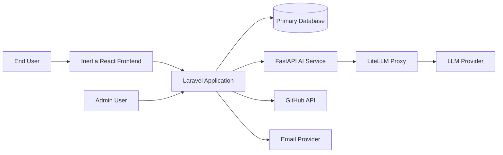
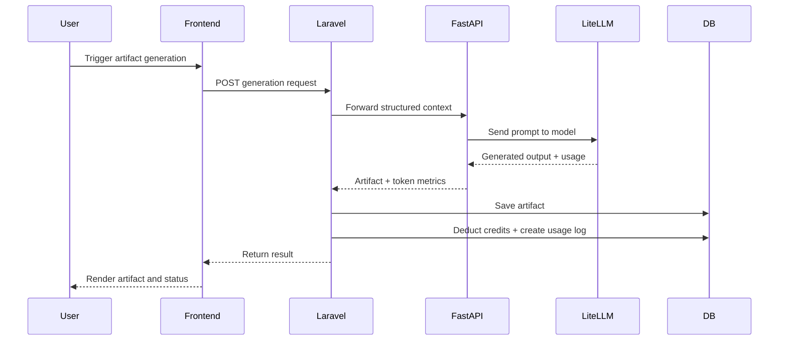
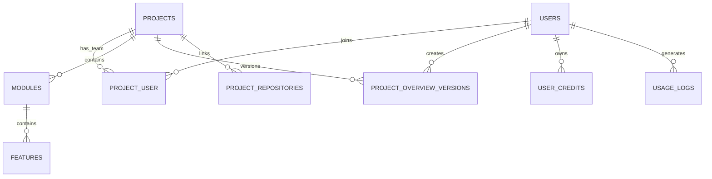
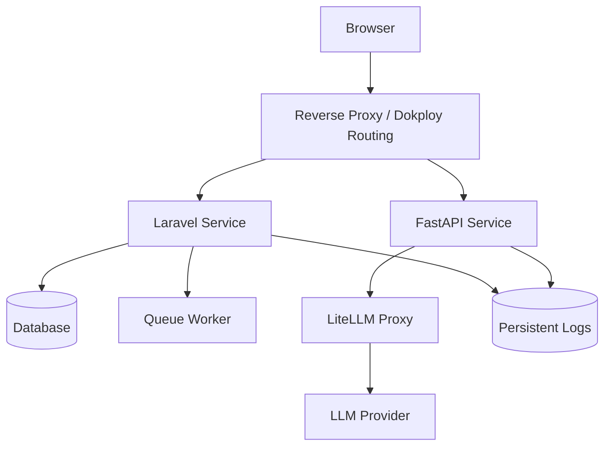

# Sirius 

Comprehensive Graduation Project Documentation Book

Version: 1.0
Date: March 18, 2026

---

## Table of Contents

1. Abstract
2. Background and Motivation
3. Problem Statement
4. Project Objectives
5. Scope and Boundaries
6. Methodology
7. Stakeholders and Roles
8. Business and Product Overview
9. Functional and Non-Functional Requirements
10. System Architecture
11. Technology Stack and Rationale
12. Implementation Details
13. End-to-End System Workflows
14. API and Integration Documentation
15. Database Design and Data Model
16. Security, Privacy, and Compliance Considerations
17. Deployment and Operations (VPS + Dokploy + Docker)
18. Testing and Validation Strategy
19. Performance, Scalability, and Reliability
20. Risk Analysis and Limitations
21. Future Enhancements
22. Conclusion
23. Appendix A: Setup and Execution Guide
24. Appendix B: Glossary

---

## 1. Abstract

Sirius is an AI-powered software planning and documentation platform that transforms a raw software idea into structured engineering artifacts. The platform focuses on the pre-implementation phase of software delivery by generating project overviews, PRDs, module and feature decomposition, ERDs, sequence diagrams, C4 architecture representations, and wireframes.

The system follows a multi-service architecture composed of:

- A Laravel-based core application for business logic, user management, collaboration, billing/credits, and web interface orchestration.
- A FastAPI microservice for AI content generation workflows.
- A LiteLLM proxy layer for model routing.
- React + Inertia.js frontend for user interaction.

This document presents complete project-level documentation in an academic-report style and technical-reference style to support graduation project evaluation, implementation audit, and operational handover.

---

## 2. Background and Motivation

Software teams often lose significant time in the discovery and planning phase due to manual preparation of project documents and architecture artifacts. Teams repeatedly perform similar activities:

- Translating abstract ideas into requirement statements.
- Drafting architecture and data models from scratch.
- Breaking large scopes into modules and implementable features.
- Synchronizing documentation quality across collaborators.

Sirius addresses this inefficiency by introducing AI-assisted generation and editing workflows that produce consistent and actionable documentation artifacts quickly, while preserving human control through editing, approval, versioning, and team collaboration.

---

## 3. Problem Statement

The key problem addressed by this project is:

"How can software teams reduce time and inconsistency in pre-code planning while preserving technical quality and collaborative control?"

Sub-problems include:

- Manual documentation is slow and inconsistent.
- Early architecture and data design are often fragmented.
- Teams lack a unified workspace connecting product planning and technical modeling.
- AI outputs without governance can become untraceable or expensive.

---

## 4. Project Objectives

Primary objectives:

1. Build an integrated platform for software pre-development planning.
2. Automate generation of major planning artifacts using AI.
3. Support module-based and feature-based decomposition workflows.
4. Enable collaboration with role-based project access.
5. Integrate usage accounting through a credit-based model.
6. Provide export/integration pathways to GitHub repositories.
7. Provide administrative visibility into users, plans, usage, and platform logs.

---

## 5. Scope and Boundaries

In scope:

- User authentication and project lifecycle management.
- AI-assisted generation/editing for overview, PRD, modules, features, ERD, sequence, C4, wireframe.
- Team invitations and role-based project collaboration.
- Credit tracking and usage logs.
- Admin portal for operational governance.
- VPS-oriented containerized deployment.

Out of scope for current release:

- Full production-grade payment orchestration details.
- Multi-region deployment and advanced distributed scaling.
- Offline-first desktop client.
- Full legal/compliance implementation (for example full SOC2 program).

---

## 6. Methodology

This project is developed using an iterative, artifact-driven approach combining:

- Requirement-first modeling from project briefs.
- AI-assisted generation with user validation loops.
- Modular decomposition to reduce design complexity.
- Event-driven synchronization for cross-artifact consistency.
- Progressive enhancement with admin and operational tooling.

The implementation reflects practical agile behavior:

- Initial artifact generation.
- Regeneration based on feedback.
- Granular edits.
- Synchronization between documents and structured models.

---

## 7. Stakeholders and Roles

Key stakeholders:

- Product user (engineer/founder/product manager): Creates and maintains project artifacts.
- Team lead/manager: Oversees project quality and team coordination.
- Administrator: Manages plans, users, beta access, logs, issues, and platform governance.
- Development/operations team: Maintains services, deployment, reliability, and monitoring.

Project-level collaboration roles in team contexts:

- Owner
- Admin
- Developer
- Viewer

---

## 8. Business and Product Overview

Sirius is positioned as a SaaS platform that turns software ideas into implementation-ready planning outputs.

Core product value:

- Faster requirement engineering.
- Better consistency across technical artifacts.
- Improved handoff from planning to implementation teams.
- Measurable usage economics via credits.

Commercial model:

- Subscription plans.
- Credit-based AI consumption.
- Optional top-up strategy for additional credits.

---

## 9. Functional and Non-Functional Requirements

### 9.1 Functional Requirements (Condensed)

1. Project creation from brief and iterative refinement.
2. Module generation and management.
3. Feature generation and management per module.
4. Artifact generation/editing:
	 - System overview
	 - PRD
	 - C4 diagrams
	 - Project ERD and module ERD
	 - Sequence diagrams
	 - Wireframes
5. Team invitation and role management.
6. GitHub integration for repository linking and initial push.
7. Credit deduction and usage log creation on AI actions.
8. Admin governance over users, plans, subscriptions, feedback, issues, and logs.

### 9.2 Non-Functional Requirements (Targeted)

- Performance: Responsive UI and acceptable AI turnaround for generation flows.
- Reliability: Stable operation with queue-backed background jobs.
- Security: Authenticated access, token-protected internal AI service, role controls.
- Maintainability: Layered services and separated Laravel/FastAPI concerns.
- Scalability: Containerized services and extensible data model.
- Observability: Logging in both Laravel and FastAPI, plus health endpoints.

---

## 10. System Architecture

### 10.1 High-Level Architecture

### 10.2 Architectural Principles

- Separation of concerns: Laravel handles business workflows; FastAPI handles AI generation.
- Orchestrator pattern: Laravel orchestrates user intent, persistence, billing, and result management.
- Prompt-driven generation: FastAPI uses template prompts per artifact type.
- Event/queue support: ERD updates can trigger project-level merge operations asynchronously.

### 10.3 Service Responsibilities

Laravel core service responsibilities:

- Authentication/session and role controls.
- CRUD and workflow logic for projects/modules/features.
- Credit accounting and usage log persistence.
- Team collaboration and invitation handling.
- Admin management and operational dashboards.

FastAPI service responsibilities:

- AI prompt loading and LLM interaction.
- Validation and shaping of generated artifact outputs.
- Usage metric return (input/output tokens and model).

---

## 11. Technology Stack and Rationale

Backend and platform:

- Laravel 12 (PHP): mature ecosystem, strong web and domain scaffolding.
- FastAPI (Python): efficient async APIs for AI workflows.
- LiteLLM proxy: abstraction layer for model routing and vendor flexibility.

Frontend:

- Inertia.js + React + TypeScript: server-driven routing with modern UI components.

Data and infrastructure:

- Laravel migrations for schema evolution.
- Docker/Compose for reproducible deployment and local development.
- Queue subsystem for background tasks.

Reasoning summary:

- This stack balances rapid feature development, maintainability, and AI integration extensibility.

---

## 12. Implementation Details

### 12.1 Monorepo Structure

- `laravel/`: Main platform (web, domain logic, admin, persistence).
- `fastAPI/`: AI generation microservice.
- `docs/`: supporting design/functional documents.
- Root scripts and compose files: local/prod orchestration.

### 12.2 Laravel Domain Implementation

Major capability areas in Laravel:

- Project lifecycle: create, update, destroy, prepare, technology intake.
- Documentation workflows: overview, PRD, C4, ERD and previews.
- Decomposition workflows: modules and features generation/regeneration.
- Feature artifact workflows: datamodel, sequence, wireframe.
- Collaboration: invitations, role updates, team membership actions.
- Integrations: GitHub OAuth/repository/link/push flow.
- Operations: admin views for logs, usage, feedback, issues, plans, users.

### 12.3 FastAPI AI Generation Implementation

FastAPI provides grouped versioned endpoints under `/v1/*`:

- Overview generation/edit.
- Module suggestions/details/single generation.
- Feature suggestions/details/single generation.
- PRD and BRD generation/edit/sync.
- ERD generation/edit/sync/merge.
- Sequence and wireframe generation/edit.
- C4 generation/edit.
- Flow generation.
- Health and logs endpoints.

### 12.4 AI Usage Accounting

In Laravel, the AI usage service computes credits from token usage returned by FastAPI:

- Total tokens = input + output.
- Credit unit = 1 credit per 1000 tokens.
- `ceil(total_tokens / 1000)` used for deduction.
- Usage persisted into logs for billing analytics and governance.

This approach standardizes charging independent of model-specific token pricing volatility.

### 12.5 Frontend Information Architecture (Inertia + React)

The frontend is organized by user context and workflow stage.

Primary page groups:

- Public pages:
	- Landing page
	- Team page
	- Beta signup page
- Auth pages:
	- Login
	- Password reset flows
	- Verification pages
- User project pages:
	- Project listing and project detail dashboard
	- Project preparation and technical intake
	- System overview and PRD editing spaces
	- Project-level ERD and C4 designer pages
	- Module index/detail and module ERD pages
	- Feature index/detail and feature artifacts (specs, datamodel, sequence, wireframe)
	- Team collaboration and invitation pages
- Settings pages:
	- Profile
	- Password
	- Usage and credits
- Admin pages:
	- Dashboard
	- Users, plans, subscriptions
	- Feedback and issue management
	- FastAPI and Laravel logs

Frontend implementation characteristics:

- Uses Inertia-driven page delivery from Laravel routes.
- Uses TypeScript-based page components for maintainability.
- Supports both synchronous and asynchronous generation UX patterns.
- Provides role-aware navigation behavior based on project and admin permissions.

### 12.6 Operational and Governance Features

Governance and moderation capabilities are built into the admin domain:

- User lifecycle visibility and selective actions (for example credits adjustments).
- Plan/subscription visibility for business control.
- Beta onboarding approval/denial flows.
- Feedback and bug triage workflows.
- Log inspection for both Laravel and FastAPI runtime diagnostics.

---

## 13. End-to-End System Workflows

### 13.1 Project-to-Artifact Workflow

### 13.2 Module and Feature Decomposition Workflow

1. User creates a project and completes initial context.
2. User requests module suggestions.
3. User confirms or regenerates modules.
4. For each module, user requests feature suggestions.
5. User accepts/refines features and enriches feature details.
6. User generates feature-level artifacts (spec, ERD, sequence, wireframe).

### 13.3 ERD Synchronization Pattern

1. Module ERD generated or edited.
2. System syncs/merges module-level data models.
3. Project-level ERD can be merged from all module ERDs.
4. Project artifact reflects consolidated schema perspective.

---

## 14. API and Integration Documentation

### 14.1 Laravel Route Domains

Primary route domains:

- Public routes: landing and beta signup.
- Authenticated project routes:
	- Project CRUD and preparation.
	- System overview and PRD flows.
	- C4 generation/edit/save.
	- Modules and features generation/CRUD.
	- Feature-level datamodel, sequence, wireframe flows.
	- Team collaboration and invitations.
	- GitHub integration flow.
- Beta feedback and issue reporting routes.
- Admin route domain:
	- Dashboard and admin management.
	- Users/plans/subscriptions.
	- Project/module/feature inspection.
	- Feedback/issues moderation.
	- FastAPI/Laravel log views and actions.

### 14.2 FastAPI Endpoint Matrix

| Group | Prefix | Core Actions |
|---|---|---|
| Overview | `/v1/Overview` | generate, edit |
| Modules | `/v1/modules` | suggestion generate/regenerate, details generate, single generate |
| Module Features | `/v1/features/module` | suggestion generate/regenerate, details generate, single generate |
| PRD | `/v1/PRD` | generate, edit, sync |
| BRD | `/v1/BRD` | generate, edit |
| ERD | `/v1/ERD` | generate, edit, sync, merge-project |
| C4 | `/v1/C4` | generate, edit |
| Sequence | `/v1/Sequence` | generate, edit |
| Wireframe | `/v1/wireframe` | generate, edit |
| Flow | `/v1/flow` | generate-flow |
| Health | `/v1/health` | health, simple |
| Logs | `/v1/logs` | fetch, stats, clear, download |

### 14.3 Integration Points

- Laravel -> FastAPI: artifact generation/edit flows.
- FastAPI -> LiteLLM: model invocation.
- Laravel -> GitHub API: repository and bootstrap operations.
- Laravel -> Email service: delivery and webhook event handling.

### 14.4 Error Handling Behavior (High-Level)

- Laravel validates requests and enforces middleware controls.
- FastAPI includes global exception handling and request IDs for traceability.
- Health endpoints provide service readiness checks.

### 14.5 Representative Laravel Route Catalog

The following table summarizes representative user-facing workflow endpoints.

| Method | Route Pattern | Purpose |
|---|---|---|
| GET | `/projects` | List user projects |
| POST | `/projects` | Create project |
| GET | `/projects/{project}` | View project dashboard |
| GET | `/projects/{project}/prepare` | Open project preparation form |
| GET | `/projects/{project}/technology` | Open technical intake |
| POST | `/projects/{project}/system-overview/create` | Generate initial system overview |
| POST | `/projects/{project}/prd/generate` | Generate PRD |
| GET | `/projects/{project}/modules` | List modules in project |
| GET | `/projects/{project}/modules/{module}/features/create` | Generate feature suggestions for a module |
| GET | `/projects/{project}/modules/{module}/features/{feature}` | Feature detail page |
| POST | `/projects/{project}/modules/{module}/erd/generate` | Generate module ERD |
| POST | `/features/{feature}/sequence-diagram/generate` | Generate feature sequence diagram |
| POST | `/features/{feature}/wireframe/generate` | Generate feature wireframe |
| GET | `/projects/{project}/github/repos` | List/link repositories |
| POST | `/projects/{project}/github/push-initial` | Push initial project artifacts/code scaffold |

### 14.6 Representative Admin Route Catalog

| Method | Route Pattern | Purpose |
|---|---|---|
| GET | `/admin/dashboard` | Admin KPI and health overview |
| GET | `/admin/users` | User listing and filtering |
| POST | `/admin/users/{user}/add-credits` | Add user credits |
| GET | `/admin/plans` | Plans management view |
| GET | `/admin/subscriptions` | Subscription monitoring |
| GET | `/admin/projects` | Global project listing |
| GET | `/admin/feedback` | Feedback moderation |
| GET | `/admin/issues` | Issue moderation |
| GET | `/admin/logs/fastapi` | FastAPI logs browser |
| GET | `/admin/logs/laravel` | Laravel logs browser |

---

## 15. Database Design and Data Model

### 15.1 Database Evolution

The migration history shows progressive expansion from core user/project tables to collaboration, admin, billing, and feedback subsystems.

Major table families:

- Identity and access: users, admins, personal access tokens.
- Core planning domain: projects, modules, features, project_overview_versions, project_technical_intakes.
- Collaboration: project_user, project_invitations.
- AI generation staging: suggested_modules, suggested_features.
- Integration: github_tokens, project_repositories.
- Billing and usage: plans, subscriptions, user_credits, usage_logs.
- Quality feedback loop: feedbacks, issue_reports, issue_comments.
- Operations: jobs/cache/pulse-related tables.

### 15.2 Core Relationship Model

### 15.3 Data Governance Notes

- Long-text artifact fields enable storage of generated content and diagrams.
- Usage logging provides auditability for AI cost/control.
- Collaboration pivot table supports role-based team behavior.

### 15.4 Key Table Purposes (Graduation Evaluation View)

| Table | Purpose |
|---|---|
| `projects` | Main container of planning artifacts and project-level metadata |
| `modules` | Domain decomposition blocks under each project |
| `features` | Implementable units under modules with detailed descriptors |
| `project_overview_versions` | Version history for generated/edited overview content |
| `project_technical_intakes` | Structured technical stack and platform preferences |
| `project_user` | Team membership and per-project role mapping |
| `project_invitations` | Pending invite flow and collaboration onboarding |
| `suggested_modules` | AI-generated module drafts before acceptance |
| `suggested_features` | AI-generated feature drafts before acceptance |
| `user_credits` | Current balance and billing cycle metadata |
| `usage_logs` | Detailed token/credit usage record per action |
| `plans` | Subscription plan definitions |
| `subscriptions` | User plan enrollment and status |
| `feedbacks` | Product feedback submissions |
| `issue_reports` | Bug report records |
| `issue_comments` | Discussion/comments on reported issues |

---

## 16. Security, Privacy, and Compliance Considerations

### 16.1 Security Controls (Current)

- Authenticated route protection in Laravel.
- Role-based admin and team access flows.
- Bearer token verification in FastAPI.
- Throttling on selected public and feedback endpoints.
- Request IDs for tracing in FastAPI.

### 16.2 Redaction and Secret Handling Policy for Documentation

This document intentionally redacts secrets and does not publish live tokens or credentials.

Examples:

- API keys: `[REDACTED]`
- Bearer tokens: `[REDACTED]`
- Secret environment values: `[REDACTED]`

### 16.3 Security Improvement Opportunities

1. Move service-to-service tokens from code to environment-managed secret stores.
2. Add token rotation and revocation policies.
3. Introduce stricter internal network controls and mTLS where applicable.
4. Expand audit trails for sensitive admin actions.

---

## 17. Deployment and Operations (VPS + Dokploy + Docker)

### 17.1 Target Deployment Topology

### 17.2 Deployment Characteristics

- Containerized services for reproducibility.
- Separation between web/business service and AI generation service.
- Environment-based configuration for production.
- Health checks and logs for operational visibility.

### 17.3 Operations Checklist

1. Configure all production env values with secrets management.
2. Build and deploy Laravel and FastAPI containers.
3. Run migrations and verify queue worker state.
4. Validate FastAPI health endpoint and Laravel app health.
5. Validate LLM proxy reachability and request latency.
6. Enable scheduled backups for database and artifacts.
7. Configure monitoring alerts for errors and service downtime.

---

## 18. Testing and Validation Strategy

### 18.1 Testing Layers

- Backend testing: Laravel PHPUnit-based testing structure.
- Service/API testing: FastAPI endpoint validation and schema checks.
- UI workflow testing: route-to-page and form workflow validation.
- Integration testing: Laravel -> FastAPI generation path.
- Operational testing: health checks and logs inspection.

### 18.2 Suggested Evaluation Test Scenarios

1. Create project and generate system overview.
2. Generate modules from project context.
3. Generate features per module and open feature detail.
4. Generate feature artifacts (ERD/sequence/wireframe).
5. Verify credit deduction and usage log creation.
6. Run admin checks for project visibility and logs.
7. Validate GitHub link and initial push flow.

### 18.3 Acceptance Indicators

- Artifacts are generated and persisted correctly.
- Credits are deducted consistently with usage.
- Team role restrictions are enforced.
- Admin tools surface platform state and issues.

---

## 19. Performance, Scalability, and Reliability

### 19.1 Performance Factors

- LLM call latency dominates artifact generation time.
- Async generation routes reduce blocking UX in long operations.
- Efficient server-side orchestration limits redundant requests.

### 19.2 Scalability Factors

- Horizontal scaling possible for Laravel and FastAPI services.
- Queue-backed tasks support workload smoothing.
- Credit system helps control runaway AI costs.

### 19.3 Reliability Factors

- Service health endpoints enable watchdog/restart behavior.
- Structured logging supports diagnosis and incident response.
- Event/listener pattern improves decoupling and maintainability.

---

## 20. Risk Analysis and Limitations

### 20.1 Key Risks

1. Secret exposure risk if hardcoded credentials remain.
2. LLM provider dependency risk (latency, outage, pricing changes).
3. AI output variability requiring human validation.
4. Cost drift risk under high-generation workloads.
5. Integration complexity across multiple services.

### 20.2 Current Limitations

- Some governance and billing edge-cases require further formalization.
- Full enterprise compliance controls are not fully documented in current scope.
- Advanced conflict resolution for collaborative editing can be expanded.

---

## 21. Future Enhancements

1. Externalize and rotate all inter-service secrets.
2. Introduce richer model-routing strategy and quality scoring per artifact.
3. Add stronger approval workflows before artifact promotion.
4. Expand analytics dashboards for team productivity and artifact quality.
5. Add broader automated test coverage and CI quality gates.
6. Add enhanced backup/restore and disaster-recovery drills.
7. Add multi-tenant enterprise capabilities and SSO enhancements.

---

## 22. Conclusion

Sirius demonstrates a complete and practical software engineering solution for pre-code planning, combining product thinking, architecture design, and AI-assisted generation in a unified platform. The project addresses a real industry bottleneck and implements a robust architecture that separates business orchestration (Laravel) from AI generation execution (FastAPI), while maintaining collaboration, governance, and operational visibility.

From a graduation project perspective, Sirius provides:

- Clear problem relevance.
- Multi-layer architecture implementation.
- Applied AI integration.
- Production-oriented deployment thinking.
- Measurable business and operational model.

The project is technically substantial, extensible, and suitable as a foundation for advanced post-graduation product evolution.

---

## 23. Appendix A: Setup and Execution Guide

### A.1 Local Development Prerequisites

- PHP and Composer
- Node.js and pnpm
- Python and pip/virtual environment tooling
- Docker (recommended for deployment parity)

### A.2 Development Startup (Monorepo)

High-level workflow:

1. Install Laravel dependencies and configure environment.
2. Run Laravel migrations.
3. Install frontend dependencies and build/dev assets.
4. Install FastAPI dependencies and configure environment.
5. Start Laravel and FastAPI services.

Expected default local service ports:

- Laravel: `http://localhost:8000`
- FastAPI: `http://localhost:8005`

### A.3 Operational Verification

1. Access web UI and authenticate.
2. Trigger one generation flow.
3. Verify artifact persistence and usage log entries.
4. Check FastAPI health and application logs.

---

## 24. Appendix B: Glossary

- PRD: Product Requirements Document.
- BRD: Business Requirements Document.
- ERD: Entity Relationship Diagram.
- C4: Context, Container, Component, and Code architecture model.
- DDD: Domain-Driven Design.
- LLM: Large Language Model.
- LiteLLM: Proxy/abstraction service for LLM provider calls.
- Inertia.js: Framework for server-side route driven SPA-like experiences.
- Usage Log: Stored record of token and credit consumption events.

---

## Documentation Integrity Note

This document is intentionally written as a single, complete graduation documentation book, combining academic narrative and technical implementation reference. Sensitive values are redacted by design.

