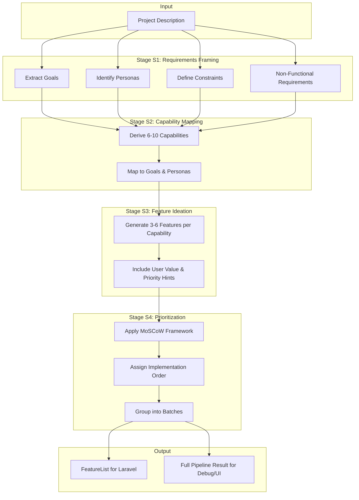
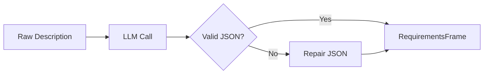
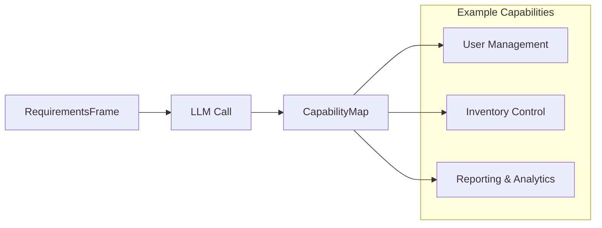
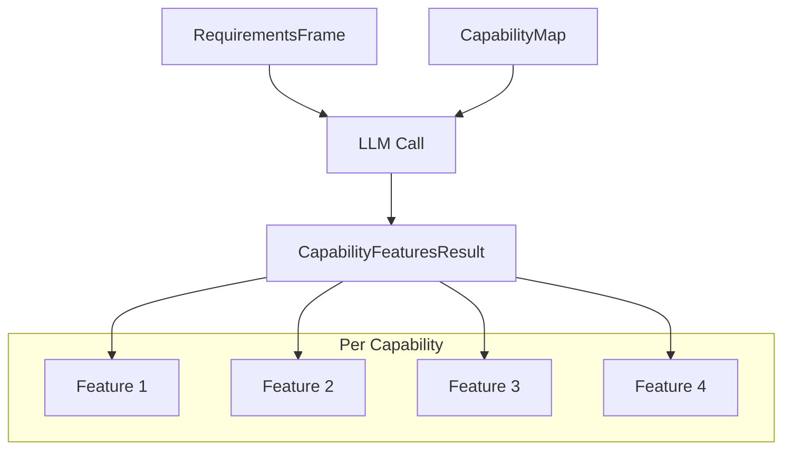
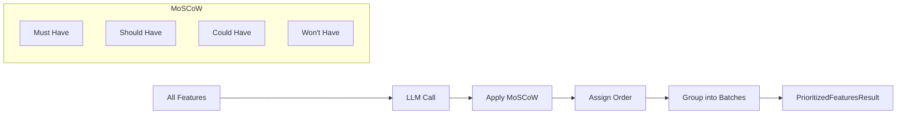
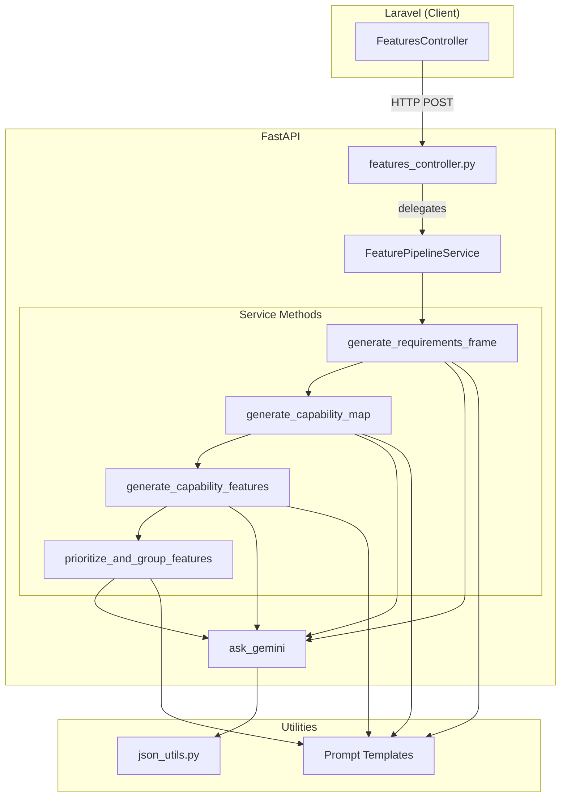
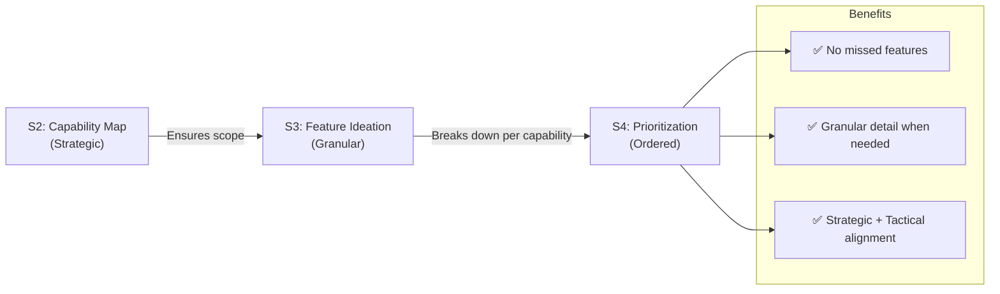

# Feature Suggestion Flow - Try 1: Multi-Stage Pipeline

## Overview

This approach replaces a single LLM call with a **4-stage pipeline** that progressively transforms a project description into prioritized, actionable features.

### Why Multi-Stage?

| Single-Stage (Before) | Multi-Stage (After) |
|----------------------|---------------------|
| One prompt → flat list of features | Structured reasoning through 4 stages |
| No context about goals/personas | Explicit requirements extraction |
| Random feature order | Prioritized with rationale |
| Hard to debug/improve | Each stage can be tuned independently |

---

## High-Level Flow



---

## Stage Details

### Stage S1: Requirements Framing

**Purpose**: Transform raw project description into structured requirements.

**Input**: `project_description` (string)

**Output**: `RequirementsFrame`
- `summary`: Normalized 2-3 sentence summary
- `goals[]`: Business/user goals with priority
- `constraints[]`: Technical/business/regulatory limitations
- `personas[]`: Key user types with their goals
- `non_functional_requirements[]`: Performance, security, etc.



**Prompt Template**: `Features-S1-Requirements.txt`

---

### Stage S2: Capability Mapping

**Purpose**: Derive high-level system capabilities from requirements.

**Input**: `RequirementsFrame` from S1

**Output**: `CapabilityMap`
- `capabilities[]`: 6-10 high-level modules
  - Each with `name`, `description`, `rationale`
  - Links to `supports_goals[]` and `supports_personas[]` by ID
- `notes`: Overall strategy notes



**Prompt Template**: `Features-S2-Capabilities.txt`

---

### Stage S3: Feature Ideation

**Purpose**: Generate concrete features for each capability.

**Input**: `RequirementsFrame` + `CapabilityMap`

**Output**: `CapabilityFeaturesResult`
- `items[]`: Features grouped by capability
  - Each capability has 3-6 `CapabilityFeature` items
  - Features include: `name`, `description`, `user_value`, `priority_hint`, `assumptions`, `risks`



**Prompt Template**: `Features-S3-FeaturesPerCapability.txt`

---

### Stage S4: Prioritization & Ordering

**Purpose**: Prioritize all features and assign implementation order.

**Input**: `RequirementsFrame` + `CapabilityMap` + `CapabilityFeaturesResult`

**Output**: `PrioritizedFeaturesResult`
- `features[]`: Flat list of all features with:
  - `priority`: must, should, could, wont (MoSCoW)
  - `implementation_order`: 1..N (unique, sequential)
  - `batch`: Optional release grouping (1 = MVP, 2 = v1.1, etc.)
  - `prioritization`: Score details with rationale
- `notes`: Prioritization strategy explanation



**Prompt Template**: `Features-S4-Prioritize.txt`

---

## Architecture



---

## Technical Details

### File Structure

```
fastAPI/src/
├── controllers/
│   └── features_controller.py    # Thin controller, delegates to service
├── services/
│   ├── __init__.py
│   └── feature_pipeline_service.py  # All pipeline logic
├── models/
│   ├── features.py               # Existing Feature/FeatureList
│   └── pipeline_features.py      # S1-S4 intermediate models
├── Prompts/
│   ├── Features-S1-Requirements.txt
│   ├── Features-S2-Capabilities.txt
│   ├── Features-S3-FeaturesPerCapability.txt
│   └── Features-S4-Prioritize.txt
└── utils/
    └── json_utils.py             # JSON extraction + repair
```

### Key Models

```python
# Stage S1 Output
class RequirementsFrame(BaseModel):
    summary: str
    goals: List[RequirementGoal]
    constraints: List[RequirementConstraint]
    personas: List[RequirementPersona]
    non_functional_requirements: List[NonFunctionalRequirement]

# Stage S2 Output
class CapabilityMap(BaseModel):
    capabilities: List[Capability]
    notes: Optional[str]

# Stage S3 Output
class CapabilityFeaturesResult(BaseModel):
    items: List[CapabilityFeatureSet]  # Features grouped by capability

# Stage S4 Output
class PrioritizedFeaturesResult(BaseModel):
    features: List[PrioritizedFeature]  # Flat, ordered list
    notes: Optional[str]
```

### API Endpoints

| Endpoint | Response | Use Case |
|----------|----------|----------|
| `POST /v1/features/suggestion/generate` | `FeatureList` | Laravel client (backward compatible) |
| `POST /v1/features/suggestion/pipeline` | `FeaturePipelineResult` | Debug, internal tools, rich UI |

### Error Handling

Each stage has:
1. **JSON extraction** from raw LLM response
2. **JSON repair** for common issues (trailing commas, truncation)
3. **Pydantic validation** for structure
4. **Stage-specific error messages** (e.g., `[S3] Invalid JSON response`)

```python
# safe_json_loads handles:
# - Trailing commas
# - Control characters
# - Truncated JSON (closes unclosed brackets)
data = safe_json_loads(json_str)
if data is None:
    raise HTTPException(500, "[S3] Invalid JSON response from AI")
```

### Token Usage

The pipeline makes **4 LLM calls** instead of 1, but:
- Each call is **more focused** and produces better results
- Total token usage is aggregated and returned
- Can cache S1/S2 results by project description hash (future enhancement)

---

## Pros & Cons

### Pros
- ✅ **Better feature quality**: Structured reasoning produces more coherent features
- ✅ **Traceability**: Can see why each feature was generated (links to goals/personas)
- ✅ **Debuggability**: Each stage can be inspected independently
- ✅ **Prioritization built-in**: Features come pre-prioritized with rationale
- ✅ **Extensible**: Easy to add caching, RAG, or feedback loops per stage

### Cons
- ❌ **Latency**: 4 sequential LLM calls (~60-90 seconds vs ~15-20 seconds)
- ❌ **Cost**: More tokens consumed (roughly 3-4x single call)
- ❌ **Complexity**: More code and prompt templates to maintain
- ❌ **Failure points**: Each stage can fail independently

---

## Future Enhancements

1. **Caching**: Cache S1/S2 by project description hash
2. **Parallel stages**: S3 could parallelize feature generation per capability
3. **RAG integration**: Retrieve similar projects/features before S3/S4
4. **Streaming**: Stream intermediate results to UI
5. **Feedback loop**: Let users rate features to improve prompts

---

## Example Output

**Input**: Pharmacy management system description (7,813 chars)

**Pipeline Results**:
- S1: 6 goals, 3 personas, 3 constraints
- S2: 6 capabilities
- S3: ~24 features (4 per capability average)
- S4: 24 prioritized features with implementation order

**Total Time**: ~66 seconds  
**Total Tokens**: ~15,000 (input + output across all stages)

---

## Feature Generation Comparison: Capabilities vs. Granular List

### Executive Summary

**Result 1 (Capability-Based)** is superior for high-level planning, strategic alignment, and architectural vision. It presents a "Product Manager's view."

**Result 2 (Granular List)** is superior for detailed sprint planning and database schema design but fails as a strategic document due to fragmentation, missing core requirements, and high token costs.

### Detailed Side-by-Side Comparison

| Metric | Result 1: Capability Map | Result 2: Granular List |
|--------|--------------------------|------------------------|
| **Structure** | Hierarchical: Features grouped by "Capability" (e.g., "Appointment Management") | Flat: Long list of isolated functions (e.g., "Booking," "Rescheduling," "Canceling") |
| **Scope Accuracy** | High: Correctly identified all core drivers, including Secure Messaging | Low: Completely missed Secure Messaging, a critical stakeholder requirement |
| **Granularity** | Strategic: Focuses on user value and "Modules" | Technical: Focuses on CRUD operations and database tasks |
| **Token Cost** | Efficient: ~2,300 tokens (Low cost, high speed) | Expensive: ~24,500 tokens (10x cost for similar value) |
| **Primary Audience** | Stakeholders & Architects: Good for sign-off and service definition | Developers: Good for writing tickets or designing schemas |

### Critical Observations

#### 1. The "Fragmentation" Problem (Result 2)

Result 2 splits a single logical service into multiple distinct features. This inflates perceived complexity.

**Example**:
- Result 1: `"Comprehensive Appointment Management"` (1 feature)
- Result 2: Broken into `"Booking"`, `"Reschedule"`, `"Cancel"`, `"Confirmation"`, `"Change Notification"`, etc. (6+ features)

**Impact**: Developers see fragmentation instead of cohesion, making it harder to design modular services.

#### 2. The "Admin Bias" (Result 2)

Result 2 heavily favors administrative functions (33% of list is Admin-focused), likely because the model over-indexed on "Control" aspects rather than "User Value."

**Impact**: The feature list skews toward backend/admin workflows, missing user-centric features.

#### 3. Strategic Omission (Result 2)

By focusing on granular details (like "Password Reset"), Result 2 ran out of "attention" or token budget before generating the Secure Messaging feature—which was a top-level requirement.

**Impact**: Critical business requirements are missed entirely.

---

## Why We Didn't Use Granular List Approach

### The Problem with Pure Granular Generation

A purely granular approach (like Result 2 above) has fundamental flaws:

1. **Scope Loss**: Without a capability map as a guardrail, LLMs tend to:
   - Generate obvious CRUD operations (Create, Read, Update, Delete)
   - Over-emphasize administrative/control flows
   - Miss strategic features (like Messaging, Reporting, etc.)

2. **Token Budget Explosion**: A flat list approach requires the LLM to hold all context at once:
   - Leads to ~10x higher token consumption
   - Makes the model "forget" important requirements mid-generation
   - Creates inconsistencies and duplicates

3. **No Strategic Context**: Developers get a list but no understanding of:
   - Why each feature exists
   - How it aligns with business goals
   - Which personas it serves
   - What capabilities it belongs to

### Why Multi-Stage (Our Approach) Is Better

Our **pipeline strategy** combines the best of both:



**Key Insight**: Use a **Capability Map as a strategic outline**, then **expand into granular features within each capability**.

This ensures:
- ✅ **Scope completeness**: S2 catches high-level requirements
- ✅ **Granular depth**: S3 generates actionable features per capability
- ✅ **Efficiency**: Each stage is focused, reducing token bloat
- ✅ **Traceability**: Every feature links back to capabilities and goals

### When to Use Each Approach

| Approach | Best For | Avoid For |
|----------|----------|-----------|
| **Capability Map (S2)** | Initial discovery, architecture, getting stakeholder buy-in | Sprint planning, database schema design |
| **Granular List (Result 2)** | Detailed sprint tickets, CRUD specifications | Strategic planning, scope completeness |
| **Pipeline (Our Approach)** | End-to-end feature generation with both strategy and detail | Simple projects with obvious scope |

---

## Recommendation

**Adopt Approach M (The Pipeline Strategy)**:

1. **Use S2 logic** for the initial "Capability Map" to ensure no major scope (like Messaging) is missed.
2. **Use S3 logic** (granular expansion) to break those capabilities down into actionable tickets for developers.
3. **Use S4 logic** to prioritize and order everything for implementation.

This gives you:
- Strategic completeness (no missed features)
- Tactical granularity (actionable details)
- Efficient token usage (focused per-stage)
- Clear traceability (feature → capability → goal)

