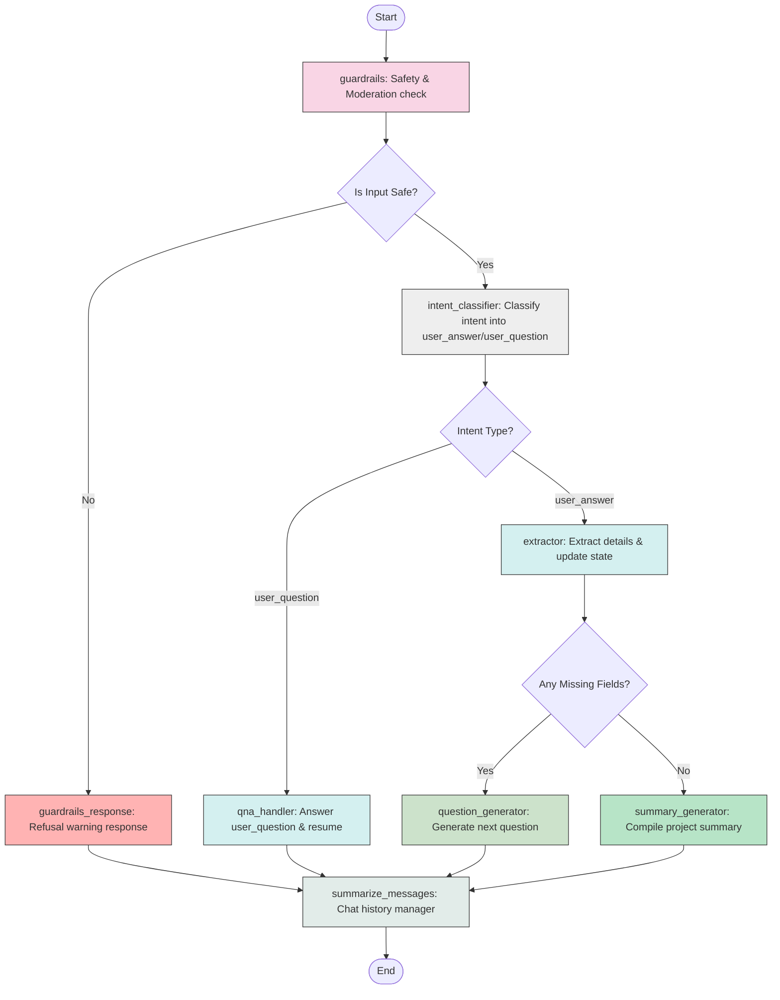

# Feature Summary: Conversational Project Intake Agent with Guardrails

We have implemented a stateful, conversational AI intake agent using LangGraph. This agent dynamically collects structured project parameters from a user while maintaining safety guardrails, routing intents based on user responses vs questions, and automatically resuming the intake flow.

---

## 🏆 Key Achievements

### 1. Stateful Conversation & Persistence (Feature 1)
- Defined `IntakeState` to keep track of:
  - `messages`: Complete conversation history.
  - `project_context`: Dynamic dictionary storing extracted values for `project_purpose`, `target_audience`, `value_proposition`, `features_overview`, and `data_model`.
  - `conversation_summary`: Summary of older conversation turns to prevent token limit issues.
  - `missing_fields`: Real-time computed list of fields that still require user input.
  - `current_question`: The active question prompted to the user.
  - `clarification_count`: Tracks the number of off-topic or safety warning turns.
  - `guardrails_result`: Safety status of the latest interaction.
  - `intent`: Active detected user intent.
  - `intent_confidence`: Confidence score of the active detected intent.
- Integrated a predictable persistence layer using `SqliteSaver` checkpointer stored in `checkpoint_intake.sqlite` next to the source directory.

### 2. Multi-Layer Guardrails & Safety
- **Moderation Check (Layer 0)**: Inspects the user's latest input message for safety violations, inappropriate content, and prompt-injection attempts. If triggered, the agent intercepts processing and outputs a polite refusal.

### 3. Intent Router (Feature 2)
- **Classifier (Layer 1)**: Evaluates user intent to classify the user message into:
  - `user_answer`: The user is providing details about their project, answering follow-up questions, or correcting specifications.
  - `user_question`: The user is asking questions, seeking clarification (e.g., "What is database?"), or chatting about unrelated topics.
- **Confidence Output**: The router returns the intent and classification confidence score (e.g. `0.94`), which are stored in the state (`intent_confidence`) and returned via the API response.
- **Routing**: The router dynamically routes to `qna_handler` if the intent is `user_question`, or `extractor` if the intent is `user_answer`.
- **Resumption**: When an off-topic question is answered, the agent answers it directly and appends a transition message with a follow-up question to resume the collection process in a single conversational turn.

### 4. Grounded Extraction & Follow-Up
- **Extraction (Layer 2)**: Evaluates the history using Grounded Inference to extract criteria without hallucinating features.
- **Dynamic Question Generator**: Targets exactly one missing field at a time with a context-aware question.
- **Summary Generator**: Formulates a structured Markdown summary of the project once all required fields are collected.

---

## 📊 Graph Visualization (Mermaid)

Below is the visual workflow map showing how messages flow through our state machine:

---

## 🚀 Registered API Route

Exposed the endpoint for Laravel or frontend components to query:
- **`POST /v1/chat/intake`**:
  - Request Model: `IntakeChatRequest` (`message`, `thread_id`)
  - Response Model: `IntakeChatResponse` (`response`, `thread_id`, `project_context`, `missing_fields`, `intent`, `intent_confidence`, `guardrails_result`, `is_complete`)
