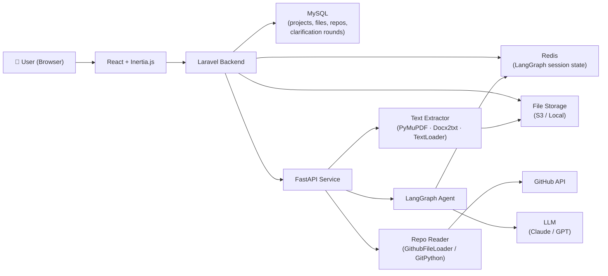
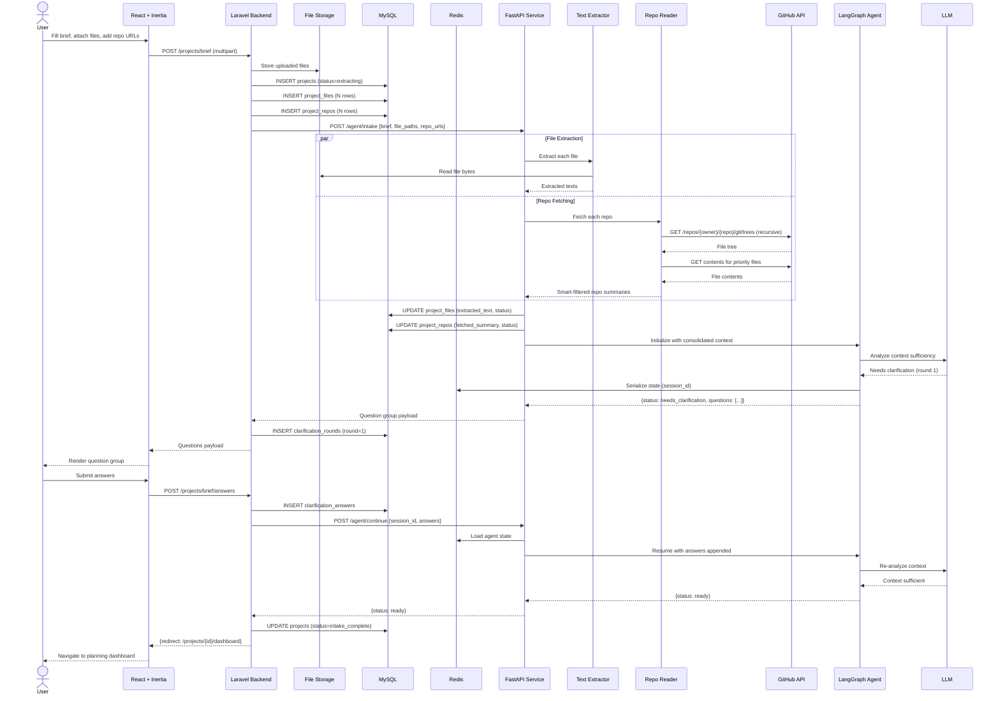

# Use Case Spec — UC-001: Flexible Project Brief Intake with AI Clarification

> **File:** `docs/use-cases/UC-001-flexible-brief-intake.md`

---

## 1. Header

| Field        | Value                                               |
| ------------ | --------------------------------------------------- |
| Use case ID  | `UC-001`                                            |
| Title        | Flexible Project Brief Intake with AI Clarification |
| Status       | Draft                                               |
| Priority     | P0                                                  |
| Owner        | Mohamed Thabet                                      |
| Last updated | 2025-01-01                                          |

---

## 2. Summary

A software engineer opens a new project in Sirius and provides context about their project through one or more input channels: a free-text brief, uploaded documents (`.txt`, `.pdf`, `.docx`), and/or links to existing GitHub repositories. A LangGraph-powered agent consolidates all provided context, performs an automated sufficiency analysis, and — if needed — asks up to three rounds of targeted clarifying questions (max 4 questions per round) before proceeding to the planning pipeline. This replaces the previous rigid questionnaire-based intake with a flexible, context-aware onboarding that dramatically reduces friction for users who already have existing specs or codebases.

---

## 3. Actors and Context

### Primary Actor
**Software Engineer (User)** — the developer creating a new project in Sirius who wants to generate pre-code planning documentation.

### Secondary Actors
| Actor | Role |
|---|---|
| **Laravel Backend** | Handles file uploads, session management, DB writes, and routes between frontend and FastAPI |
| **FastAPI Service** | Orchestrates text extraction from files and repo reading; hosts the LangGraph agent |
| **LangGraph Agent** | Stateful AI agent that analyzes context sufficiency and generates question groups |
| **LLM (Claude/GPT)** | Powers the agent's reasoning for sufficiency analysis and question generation |
| **GitHub API** | Provides file tree and file contents from linked repositories |
| **File Storage (S3/local)** | Persists uploaded files temporarily during intake and long-term for project records |
| **Redis** | Stores serialized LangGraph agent state between question rounds |

### Preconditions
- [x] User is authenticated and has an active session
- [x] User has an existing Sirius account with a team or personal workspace
- [x] FastAPI service is reachable from Laravel backend
- [x] GitHub OAuth token is available (if user links a repo)
- [x] Redis is running for agent state persistence

### Postconditions (success)
- [x] A `projects` record is created with status `intake_complete`
- [x] All uploaded files are stored in file storage and referenced in `project_files`
- [x] All provided repo URLs are stored in `project_repos`
- [x] All clarification rounds and answers are stored in `clarification_rounds` / `clarification_answers`
- [x] The consolidated context and agent output are persisted on the `projects` record
- [x] User is redirected to the project planning dashboard

### Postconditions (failure)
- [x] If file extraction fails, the file is marked `extraction_failed` in `project_files` and the user is notified; intake continues with remaining context
- [x] If GitHub API is unreachable, the repo is marked `fetch_failed` in `project_repos`; intake continues
- [x] If the agent fails after 3 rounds without reaching sufficiency, it proceeds anyway with a `low_confidence` flag

---

## 4. Traceability

| Type                      | IDs / References                        |
| ------------------------- | --------------------------------------- |
| Functional requirements   | `FR-001` (Project Creation), `FR-002` (Project Decomposition), `FR-003` (Documentation Generation) |
| Non-functional requirements | `NFR-001` (Response < 5s for file extraction), `NFR-002` (Support files up to 20MB), `NFR-003` (GitHub API rate limit handling) |
| PRD                       | Sirius PRD v2 — Section 3: Brief Intake & Context Engine |

---

## 5. User Journey (Happy Path)

1. **User navigates** to "New Project" in the Sirius dashboard.
2. **User types** a free-text brief into the large textarea (optional but encouraged).
3. **User uploads** one or more context files (`.txt`, `.pdf`, `.docx`) via drag-and-drop or file picker.
4. **User pastes** one or more GitHub repository URLs into the repo input (optional).
5. **User clicks "Analyze Brief"** — React sends a multipart `POST /projects/brief` to Laravel.
6. **Laravel** validates the request, stores uploaded files to S3/local, creates DB records (`projects`, `project_files`, `project_repos`), and sends the context payload to FastAPI.
7. **FastAPI** extracts text from each uploaded file in parallel (`PyMuPDFLoader` for PDF, `Docx2txtLoader` for DOCX, `TextLoader` for TXT).
8. **FastAPI** calls the GitHub API for each repo: reads the file tree, then fetches priority files (README, dependency manifests, schema files) within token budget.
9. **LangGraph agent** is initialized with the consolidated context (brief + file texts + repo summaries). State is serialized to Redis with a `session_id`.
10. **Agent analyzes** the context. Determines it needs more information (round 1 of max 3).
11. **FastAPI returns** `{ status: "needs_clarification", round: 1, session_id: "...", questions: [...] }` to Laravel.
12. **Laravel** stores the question group in `clarification_rounds` and returns the payload to React.
13. **React renders** the question group dynamically (text inputs, selects, booleans per question type).
14. **User answers** the questions and clicks "Continue".
15. **React sends** answers to `POST /projects/brief/answers` — Laravel persists to `clarification_answers` and forwards to `POST /agent/continue` on FastAPI.
16. **FastAPI resumes** the LangGraph agent from Redis state with answers appended.
17. **Agent re-analyzes** — context is now sufficient. Emits `{ status: "ready" }`.
18. **FastAPI triggers** the planning pipeline (PRD generation, ERD, etc.) asynchronously.
19. **Laravel** updates `projects.status` to `intake_complete` and returns a redirect.
20. **User lands** on the project planning dashboard with generated artifacts loading in.

---

## 6. Alternative and Error Flows

| #  | Condition | Expected Behavior |
| -- | --------- | ----------------- |
| A1 | User submits only a text brief (no files, no repo) | Flow proceeds normally; agent works with text only and may ask more questions |
| A2 | User uploads a file that fails extraction (corrupted PDF, password-protected DOCX) | File marked `extraction_failed`; toast warning shown; other context still submitted |
| A3 | GitHub repo URL is invalid or private without proper auth | Repo marked `fetch_failed`; user shown a warning to check the URL or connect GitHub OAuth |
| A4 | GitHub API rate limit hit during repo fetch | System retries with exponential backoff (3 attempts); if still failing, proceeds without repo context |
| A5 | Agent reaches 3 question rounds without flagging sufficiency | Agent proceeds with `low_confidence: true` flag; user sees a warning banner on the planning dashboard |
| A6 | User closes the tab during a question round | Session state preserved in Redis (TTL 2 hours); user can resume via the project list |
| A7 | Uploaded file exceeds 20MB size limit | Laravel rejects at upload with a clear error message before sending to FastAPI |
| A8 | User provides no input at all and clicks submit | React-side validation prevents submission; user prompted to add at least a text brief |
| A9 | FastAPI service is unreachable | Laravel returns a 503 with a user-facing error; project record created with status `pending_retry` |

---

## 7. Data and Contracts

### 7a. Database Design

#### `projects`
| Column | Type | Notes |
|---|---|---|
| `id` | ULID PK | |
| `user_id` | FK → users | |
| `workspace_id` | FK → workspaces | |
| `title` | varchar(255) | Auto-generated or user-set |
| `raw_brief` | text | User's free-text brief |
| `consolidated_context` | longtext | Merged brief + file texts + repo summaries (stored post-extraction) |
| `agent_session_id` | varchar(100) | Redis key for LangGraph state |
| `status` | enum | `drafting`, `extracting`, `clarifying`, `intake_complete`, `planning`, `done`, `failed` |
| `low_confidence` | boolean | True if agent hit max rounds without full sufficiency |
| `created_at` | timestamp | |
| `updated_at` | timestamp | |

#### `project_files`
| Column | Type | Notes |
|---|---|---|
| `id` | ULID PK | |
| `project_id` | FK → projects | |
| `original_name` | varchar(255) | Original filename from user |
| `storage_path` | varchar(500) | Path in S3/local storage |
| `mime_type` | varchar(100) | `application/pdf`, `text/plain`, etc. |
| `file_size_bytes` | bigint | |
| `extraction_status` | enum | `pending`, `extracted`, `extraction_failed` |
| `extracted_text` | longtext | Extracted plain text content (nullable) |
| `extraction_error` | text | Error message if extraction failed (nullable) |
| `created_at` | timestamp | |

#### `project_repos`
| Column | Type | Notes |
|---|---|---|
| `id` | ULID PK | |
| `project_id` | FK → projects | |
| `repo_url` | varchar(500) | Full GitHub URL |
| `owner` | varchar(100) | Parsed from URL |
| `repo_name` | varchar(100) | Parsed from URL |
| `default_branch` | varchar(100) | Fetched from GitHub API |
| `fetch_status` | enum | `pending`, `fetched`, `fetch_failed` |
| `fetched_summary` | longtext | Smart-filtered repo content (nullable) |
| `fetch_error` | text | Error message if fetch failed (nullable) |
| `files_fetched_count` | int | How many files were actually read |
| `total_tokens_used` | int | Approximate token count of fetched content |
| `created_at` | timestamp | |

#### `clarification_rounds`
| Column | Type | Notes |
|---|---|---|
| `id` | ULID PK | |
| `project_id` | FK → projects | |
| `round_number` | tinyint | 1, 2, or 3 |
| `questions_payload` | json | Full question group as emitted by agent |
| `status` | enum | `pending`, `answered` |
| `created_at` | timestamp | |
| `answered_at` | timestamp | Nullable |

#### `clarification_answers`
| Column | Type | Notes |
|---|---|---|
| `id` | ULID PK | |
| `clarification_round_id` | FK → clarification_rounds | |
| `question_id` | varchar(50) | e.g., `q1`, `q2` matching the questions_payload |
| `question_text` | text | Snapshot of the question for readability |
| `answer_value` | text | User's answer (stringified for flexibility) |
| `created_at` | timestamp | |

---

### 7b. Key Reads / Writes

| Operation | Table(s) | Trigger |
|---|---|---|
| Create project shell | `projects` | User clicks "Analyze Brief" |
| Store files metadata | `project_files` (N rows) | After upload validation |
| Store repo records | `project_repos` (N rows) | After URL parsing |
| Write extracted text | `project_files.extracted_text` | After FastAPI extraction |
| Write repo summary | `project_repos.fetched_summary` | After GitHub API fetch |
| Write consolidated context | `projects.consolidated_context` | After all extraction done |
| Create clarification round | `clarification_rounds` | Each time agent emits questions |
| Write answers | `clarification_answers` | User submits answers |
| Update project status | `projects.status` | At each phase transition |

---

### 7c. API Contracts

#### `POST /projects/brief` (Laravel)
**Request (multipart/form-data):**
```json
{
  "brief_text": "We are building a marketplace for...",
  "files": ["<binary>", "<binary>"],
  "repo_urls": ["https://github.com/org/repo1", "https://github.com/org/repo2"]
}
```
**Response:**
```json
{
  "project_id": "01J...",
  "status": "needs_clarification",
  "round": 1,
  "session_id": "sess_abc123",
  "questions": [
    { "id": "q1", "text": "Who are the primary users of this system?", "type": "text" },
    { "id": "q2", "text": "What is the primary monetization model?", "type": "select", "options": ["Subscription", "Per-transaction fee", "Freemium", "One-time purchase"] },
    { "id": "q3", "text": "Do you have an existing codebase this will integrate with?", "type": "boolean" }
  ]
}
```

#### `POST /projects/brief/answers` (Laravel)
**Request:**
```json
{
  "project_id": "01J...",
  "session_id": "sess_abc123",
  "round": 1,
  "answers": [
    { "question_id": "q1", "value": "Freelancers and clients" },
    { "question_id": "q2", "value": "Per-transaction fee" },
    { "question_id": "q3", "value": "false" }
  ]
}
```
**Response (if agent is satisfied):**
```json
{
  "status": "ready",
  "project_id": "01J...",
  "redirect": "/projects/01J.../dashboard"
}
```
**Response (if another round needed):**
```json
{
  "status": "needs_clarification",
  "round": 2,
  "questions": [...]
}
```

---

### 7d. External Integrations

| Integration | Purpose | Notes |
|---|---|---|
| **GitHub REST API** | Fetch repo tree (`GET /repos/{owner}/{repo}/git/trees/{sha}?recursive=1`) and file contents | Requires OAuth token or PAT; rate limit: 5000 req/hr authenticated |
| **LangChain PyMuPDFLoader** | PDF text extraction | `pip install pymupdf`; handles multi-page, complex layouts |
| **LangChain Docx2txtLoader** | DOCX text extraction | `pip install docx2txt` |
| **LangChain TextLoader** | TXT extraction | Built-in |
| **LangGraph** | Stateful agent orchestration with round-based question flow | State serialized to Redis between HTTP requests |
| **Redis** | Agent state persistence between question rounds | TTL: 2 hours per session |
| **S3 / Local Storage** | File storage | Laravel `Storage` facade with configurable driver |

---

## 8. Architecture Diagram



---

## 9. Sequence Diagram



---

## 10. Acceptance Criteria (Testable)

- [ ] **GIVEN** a user submits only a text brief with no files or repos **WHEN** the agent analyzes it **THEN** the system proceeds (asking questions if needed) without errors
- [ ] **GIVEN** a user uploads a valid PDF **WHEN** extraction runs **THEN** `project_files.extraction_status` = `extracted` and `extracted_text` is non-empty
- [ ] **GIVEN** a user uploads a corrupted PDF **WHEN** extraction fails **THEN** `extraction_status` = `extraction_failed`, error is logged, and the intake continues with remaining context
- [ ] **GIVEN** a valid GitHub repo URL **WHEN** fetching runs **THEN** `project_repos.fetch_status` = `fetched` and `fetched_summary` contains at least the README content
- [ ] **GIVEN** a private GitHub repo URL without auth **WHEN** fetching runs **THEN** `fetch_status` = `fetch_failed` and the user sees a clear warning message
- [ ] **GIVEN** the agent needs clarification **WHEN** it emits a question group **THEN** the response contains at most 4 questions and round number ≤ 3
- [ ] **GIVEN** the agent has asked 3 rounds **WHEN** sufficiency is still not reached **THEN** it proceeds anyway with `projects.low_confidence = true`
- [ ] **GIVEN** a user closes the tab during round 2 **WHEN** they return within 2 hours **THEN** the session resumes from round 2 (Redis state preserved)
- [ ] **GIVEN** a user uploads a file > 20MB **WHEN** submitted **THEN** Laravel rejects it with a validation error before any processing
- [ ] **GIVEN** the project reaches `intake_complete` **WHEN** the user is redirected **THEN** the project dashboard shows a loading state for planning artifacts

---

## 11. Out of Scope (This Use Case Only)

- The actual planning pipeline (PRD, ERD, sequence diagram generation) triggered after intake — covered in `UC-002`
- GitHub OAuth connection flow (user linking their GitHub account) — covered in `UC-010`
- Team collaboration on the brief (multiple users editing simultaneously) — covered in `UC-006`
- Billing / usage limits for file processing or API calls
- Support for file formats beyond `.txt`, `.pdf`, `.docx`
- Support for non-GitHub repositories (GitLab, Bitbucket, self-hosted)
- Real-time progress streaming during file extraction (shown as a loading state only)

---

## 12. Open Questions

- Should uploaded files be permanently stored per-project or cleaned up after the consolidated context is generated? (Storage cost vs. auditability tradeoff)
- What is the maximum total token budget across all files + repos + brief? Need to define the ceiling to prevent LLM context overflow (suggested: 32K tokens total input budget).
- Should the agent question types support multi-select or ranked options in addition to text/select/boolean?
- Should `consolidated_context` be stored encrypted at rest, given it may contain sensitive IP from private repos?
- Is there a need to support resuming an intake session across devices (not just same-browser)? If so, session linkage must be user-scoped in DB, not just Redis.
- What happens to the Redis state after `intake_complete`? Delete immediately or keep for a grace period for debugging?