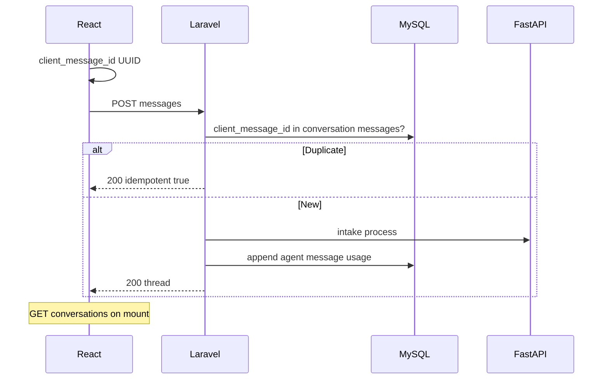
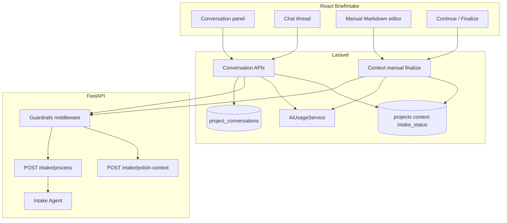
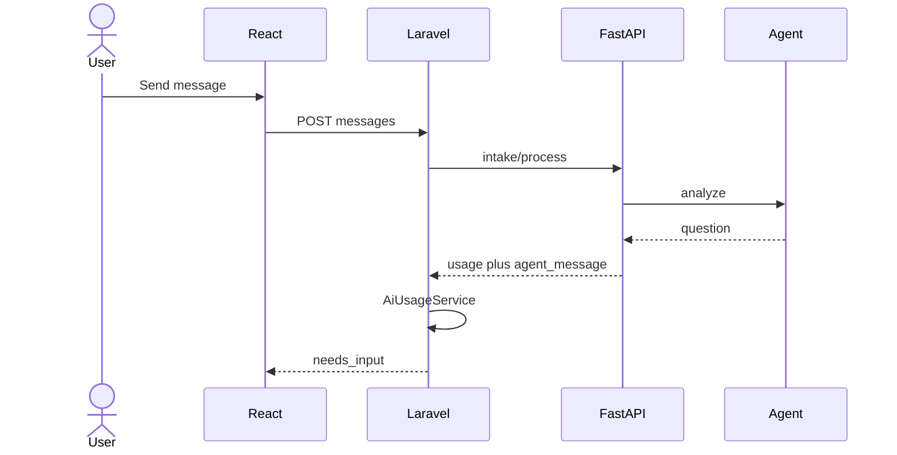
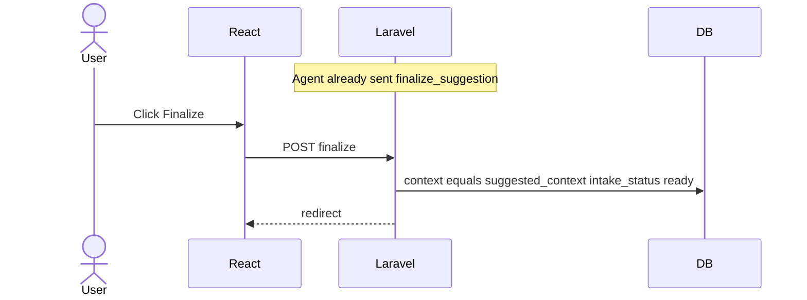
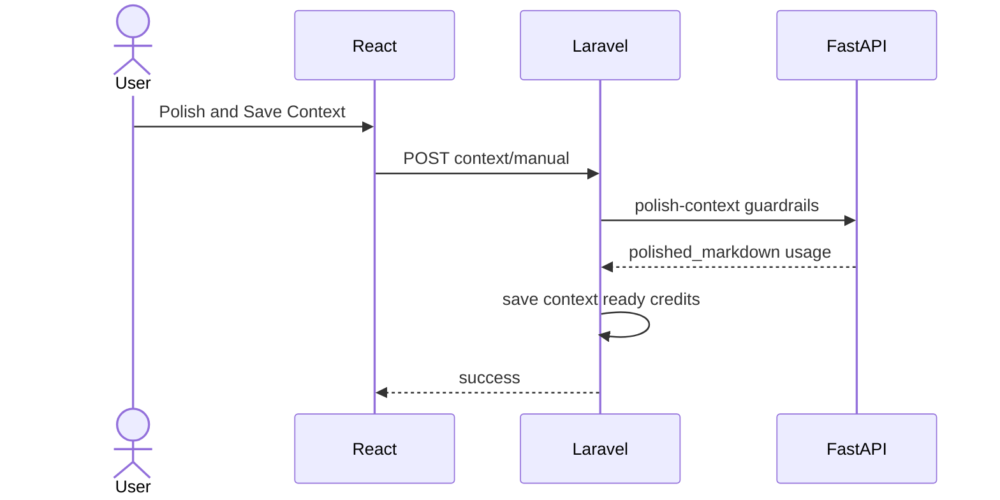

# Use Case Spec — UC-001: Flexible Project Intake with AI Clarification

> **File:** `docs/v0.2/v0.2.1/use-cases/uc-001-flexible-brief-intake.md`

---

## 1. Header

| Field        | Value                                               |
| ------------ | --------------------------------------------------- |
| Use case ID  | `UC-001`                                            |
| Title        | Flexible Project Intake with AI Clarification       |
| Status       | Draft                                               |
| Priority     | P0                                                  |
| Owner        | Mohamed Thabet                                      |
| Last updated | 2026-06-05                                          |

---

## 2. Summary

A software engineer creates a new project in Sirius and opens **Project Intake** (`/projects/{project}/brief-intake`) — a chat-style interface that replaces the legacy Prepare wizard (`Prepare.tsx`). The user can supply project context in two ways:

1. **Chat-assisted intake** — free text, uploaded documents (`.txt`, `.pdf`, `.docx`, `.md`), and/or GitHub repo URLs. Each turn is sent to Laravel, persisted in `project_conversations.messages` (JSON), and processed by a LangGraph intake agent via FastAPI. The agent may respond with normal discussion (`text`), structured or freeform questions (`question`), or a proposed final Markdown context (`finalize_suggestion`). Only the **user** may finalize: clicking **Finalize** writes `projects.context` and sets `intake_status = ready`.

2. **Manual Markdown context** — the user authors project context directly in a Markdown editor (GFM, no raw HTML), accepts an accuracy disclaimer, and submits **Polish and Save Context**. Laravel validates, FastAPI guardrails check for prompt injection/disallowed content, the agent polishes content to Sirius context format, and on success Laravel saves `projects.context` and sets `intake_status = ready` in one explicit user action.

**Source of truth:** `projects.context` is a `longText` Markdown field. **`projects.brief` is removed** after migration; navigation and downstream pipelines use `intake_status` and `context` instead.

**Opening intake:** Any project with `intake_status != ready` is routed to Project Intake. Projects with populated context (including legacy backfill) have `intake_status = ready`.

**Replaces:** `projects.brief`, `projects.brief_messages`, durable `project_files` storage for intake, batch `POST /projects/brief`, `clarification_rounds` / `clarification_answers`, and agent-auto-finalize behavior.

---

## 3. Actors and Context

### Primary Actor

**Software Engineer (User)** — creates a project and establishes authoritative project context for downstream documentation.

### Secondary Actors

| Actor | Role |
| --- | --- |
| **React + Inertia.js** | Project Intake UI: chat, manual Markdown editor, conversation sidebar, finalize controls, context preview |
| **Laravel Backend** | Auth, validation, conversation persistence, `context` writes, FastAPI orchestration, credits via `AiUsageService`, idempotent APIs |
| **FastAPI Service** | Intake agent, context polish, guardrails middleware, ephemeral file/repo extraction |
| **LangGraph Intake Agent** | Discussion, questions, finalize suggestions; checkpointed by `project_id` + `conversation_id` |
| **LLM** | Reasoning, polish, question generation |
| **GitHub API** | Repo tree and priority file contents (ephemeral) |

> **Note:** MySQL is the source of truth for conversations and `projects.context`. Uploaded file **bytes are not stored**; only metadata and short excerpts may appear in conversation JSON.

### Preconditions

- [x] User is authenticated
- [x] User owns the project (or has policy-granted access)
- [x] FastAPI is reachable (`config('app.fastapi_base_url')`)
- [x] User has sufficient credits for LLM-backed intake turns (see Section 7f)
- [x] GitHub OAuth token available for private repos when linking (UC-010)

### Postconditions (success — chat finalize)

- [x] `projects.intake_status` = `ready`
- [x] `projects.context` contains user-approved Markdown context
- [x] Active `project_conversations` row contains full thread with usage metadata on AI messages
- [x] User may navigate to System Overview or other project sections per navigation rules

### Postconditions (success — manual polish and save)

- [x] `projects.intake_status` = `ready`
- [x] `projects.context` contains polished Markdown (disclaimer recorded on conversation or project metadata)
- [x] No durable file rows created for intake uploads

### Postconditions (failure)

- [x] Guardrail or validation failure: context not saved; `intake_status` remains `draft` or `needs_input`; user sees actionable error
- [x] Ephemeral file/repo extraction failure: attachment metadata shows `failed`; intake continues with remaining input
- [x] FastAPI unreachable: message `status: failed`; `intake_status` = `failed`; retry available
- [x] Duplicate submit: idempotent 200, no duplicate agent turn or credit charge

---

## 4. Traceability

| Type | IDs / References |
| --- | --- |
| Functional requirements | `FR-001`, `FR-002`, `FR-003` |
| Non-functional requirements | `NFR-001`, `NFR-002`, `NFR-003` |
| PRD | Sirius PRD v2 — Section 3: Project Intake & Context Engine |
| Supersedes | Legacy Prepare wizard for **new** projects |
| Downstream | System Overview, Technical Details, Architecture, ERD, PRD (see Section 14) |

---

## 5. User Journeys

### 5a. Happy Path — Chat-Assisted Intake

1. User creates project (`POST /projects`) with name only; `intake_status` = `draft`.
2. Laravel redirects to `/projects/{project}/brief-intake` when `intake_status != ready`.
3. Laravel creates or loads the **active** `project_conversations` row for intake mode `chat`.
4. User sends first message (text and/or ephemeral files/repos).
5. React sends `POST /projects/{project}/conversations/{conversation}/messages` with `client_message_id` (UUID).
6. Laravel validates, extracts file/repo content in-process or via FastAPI **without persisting bytes**, appends user message, sets `intake_status` = `processing`, calls `POST /v1/intake/process`.
7. FastAPI returns agent message (`text` or `question`), `usage`, and optional working draft; Laravel sets `intake_status` = `needs_input`, records credits.
8. User answers questions or continues discussion; steps 5–7 repeat.
9. Agent returns `finalize_suggestion` with proposed Markdown `suggested_context`; Laravel sets `intake_status` = `needs_input` (does **not** write `projects.context`).
10. User clicks **Continue** (keeps chatting) or **Finalize**.
11. On **Finalize**, Laravel writes `suggested_context` to `projects.context`, sets `intake_status` = `ready`, returns redirect to `/projects/{project}/system-overview` (or project hub per product decision).

### 5b. Happy Path — Manual Markdown (Polish and Save)

1. User opens Project Intake; switches to **Write context** tab or equivalent.
2. UI shows recommended sections template (users, stakeholders, business goals, constraints, tech stack, etc.) and **accuracy disclaimer** (Sirius not responsible for accuracy of user-supplied manual input).
3. User edits Markdown with full editor tooling (headings, lists, tables, code fences, links, task lists); live syntax check; GFM only, **no raw HTML**.
4. User clicks **Polish and Save Context** (explicit finalize).
5. React validates locally → Laravel `StoreManualContextRequest` validates → FastAPI `POST /v1/intake/polish-context` runs guardrails + polish.
6. On success, Laravel saves polished Markdown to `projects.context`, sets `intake_status` = `ready`, logs credits from `usage`, optionally appends `manual_context` message to active conversation.

### 5c. Navigation and Intake Gate

| `intake_status` | Project Intake page | Other project sections |
| --- | --- | --- |
| `draft` | Open (required for new projects) | Locked or redirect to intake |
| `processing` | Open (read-only composer, poll) | Locked or redirect |
| `needs_input` | Open | Locked or redirect |
| `failed` | Open with retry | Locked or redirect |
| `ready` | Optional revisit for new conversation | Unlocked |

Legacy migration: projects with base System Overview and/or old `brief` receive composed `context` and `intake_status = ready` (Section 7a).

---

## 5d. Idempotency and Navigation



| Layer | Mechanism |
| --- | --- |
| **React** | `client_message_id` per send; disable while pending; hydrate via `GET`; conversation sidebar switches active thread |
| **Laravel** | Idempotency scan on `project_conversations.messages`; 409 when `intake_status = processing` |
| **FastAPI** | Stateless per request; LangGraph `thread_id` = `{project_id}:{conversation_id}` |

---

## 6. Alternative and Error Flows

| # | Condition | Expected Behavior |
| - | --------- | ----------------- |
| A1 | Text-only message | Agent may `text` or `question` |
| A2 | File extraction fails | Metadata `failed` on attachment; no storage row; intake continues |
| A3 | Invalid GitHub URL | Repo metadata `fetch_failed`; warning inline |
| A4 | GitHub rate limit | Backoff 3x; proceed without repo |
| A5 | Double-click Send | Idempotent 200 |
| A6 | Navigate away and return | `GET` restores conversation + status |
| A7 | File > 20MB | Rejected before processing |
| A8 | Empty message | React + Laravel reject |
| A9 | FastAPI down | `failed` message; `intake_status` = `failed` |
| A10 | POST while `processing` | 409 + poll |
| A11 | Guardrails block content | 422; no context write; no credits or partial credits per policy |
| A12 | Insufficient credits | 402/403 before FastAPI call |
| A13 | User clicks Continue on finalize suggestion | Thread continues; `context` unchanged |
| A14 | Legacy project after migration | `ready` + `context` populated; skip forced intake |

---

## 7. Data and Contracts

### 7a. Database Design

#### `projects` (changes)

| Column | Type | Notes |
| --- | --- | --- |
| `id` | bigint PK | Existing |
| `user_id` | FK | Existing |
| `name` | varchar | Existing |
| `context` | longText, nullable | **Source of truth** — Markdown project context |
| `intake_status` | varchar | `draft`, `processing`, `needs_input`, `ready`, `failed` |
| `intake_processing_at` | timestamp, nullable | Concurrency lock |
| `manual_context_disclaimer_accepted_at` | timestamp, nullable | Optional audit for manual path |
| `status` | enum | Unchanged lifecycle |
| `overview_chat` | json | Unchanged — separate from intake |
| `created_at`, `updated_at` | timestamps | Existing |

**Removed:** `brief`, `brief_messages` (after migration).

**Migrations (ordered):**

1. `add_intake_columns_to_projects_table.php` — add `context` (longText), `intake_status` (default `draft`), `intake_processing_at`, disclaimer timestamp.
2. `backfill_projects_context_from_legacy.php` — for each project:
   - If base `project_overview_versions.is_base_version` overview exists, append under `## System Overview`.
   - If legacy `brief` non-empty, append under `## Project Brief (Legacy)`.
   - If either exists → `intake_status = ready`; else `draft`.
3. `migrate_brief_consumers_to_context.php` — application code deploy (Section 14).
4. `drop_brief_column_from_projects_table.php` — drop `brief` only after step 3 verified.

**Model (`Project.php`):**

```php
// context is plain string Markdown — no JSON cast
'intake_processing_at' => 'datetime',
'manual_context_disclaimer_accepted_at' => 'datetime',
```

#### `project_conversations`

| Column | Type | Notes |
| --- | --- | --- |
| `id` | ULID PK | |
| `project_id` | FK → projects | |
| `user_id` | FK → users | Creator |
| `mode` | varchar | `chat`, `manual_context`, `context_edit` (future) |
| `title` | varchar, nullable | Auto: "Intake chat", "Manual context", or first message snippet |
| `status` | varchar | `active`, `archived` |
| `is_current` | boolean | One current intake conversation per project/mode (enforce in app) |
| `messages` | json | Ordered message array (schema below) |
| `created_at`, `updated_at` | timestamps | |

**Indexes:** `(project_id, is_current)`, `(project_id, updated_at)`.

#### Message item schema (`project_conversations.messages[]`)

```json
{
  "id": "550e8400-e29b-41d4-a716-446655440000",
  "client_message_id": "660e8400-e29b-41d4-a716-446655440001",
  "role": "user",
  "kind": "text",
  "content": "We are building a marketplace...",
  "attachments": [
    {
      "type": "file",
      "original_name": "spec.pdf",
      "mime_type": "application/pdf",
      "file_size_bytes": 1048576,
      "status": "processed",
      "excerpt": "First 500 chars or AI summary — not full file"
    }
  ],
  "question": null,
  "answers": null,
  "suggested_context": null,
  "usage": null,
  "credits_used": null,
  "status": "completed",
  "created_at": "2026-06-05T10:00:00Z"
}
```

#### Message `kind` values

| kind | role | Description |
| --- | --- | --- |
| `text` | user / agent | Free text; agent uses for discussion or explanation |
| `answer` | user | Reply to agent `question` |
| `manual_context` | user | Raw manual Markdown submitted (before polish) — optional audit |
| `question` | agent | Structured and/or freeform clarification (`question` object) |
| `finalize_suggestion` | agent | Proposed final Markdown in `suggested_context`; awaits user Finalize |
| `system` | system | Errors, retries, guardrail blocks |

**Agent `question` object** (same structure as prior clarification schema):

```json
{
  "questions": [
    {
      "id": "q1",
      "text": "Who are the primary users?",
      "selection_mode": "single",
      "recommended_option_id": "opt_a",
      "options": [
        { "id": "opt_a", "label": "Freelancers and clients" }
      ],
      "allow_custom_text": true
    }
  ]
}
```

**User `answers` payload:**

```json
{
  "answers": [
    { "question_id": "q1", "selected_option_ids": ["opt_a"], "custom_text": null }
  ],
  "in_reply_to_message_id": "agent-msg-uuid"
}
```

**Agent `finalize_suggestion`:**

```json
{
  "content": "I believe we have enough detail. Review the proposed context below.",
  "suggested_context": "# Project Context\n\n## Users\n...\n\n---\n*Disclaimer: ...*"
}
```

#### Recommended manual context template (UI only)

Displayed as placeholder/helper, not enforced schema:

- Users / personas
- Stakeholders
- Business goals
- Problem statement
- Scope (in / out)
- Constraints and compliance
- Success metrics
- Technical stack (optional)
- Integrations (optional)

#### Ephemeral attachments — **no `project_files` / `project_repos` for intake**

| Step | Behavior |
| --- | --- |
| Upload | Bytes held in request memory/temp disk only |
| Extract | FastAPI or Laravel inline extraction |
| Persist | **Only** attachment metadata + optional `excerpt` on message JSON |
| Delete | Temp files deleted before response completes |

> **Deprecated for UC-001:** `project_files`, `project_repos` tables for intake flow.

---

### 7b. Key Reads / Writes

| Operation | Table(s) | Trigger |
| --- | --- | --- |
| List conversations | `project_conversations` | `GET .../conversations` |
| Load thread | `project_conversations.messages`, `intake_status` | `GET .../conversations/{id}` |
| Send chat message | `project_conversations` | `POST .../messages` |
| Finalize context | `projects.context`, `intake_status` | `POST .../finalize` (user only) |
| Manual polish save | `projects.context`, `intake_status` | `POST .../context/manual` |
| Credits | `usage_logs`, `user_credits` | After each successful LLM response |

---

### 7c. API Contracts (Laravel)

#### `GET /projects/{project}/brief-intake`

Inertia page props: `project`, `intake_status`, `context` (if ready), `conversations[]`, `activeConversationId`.

#### `GET /projects/{project}/conversations`

```json
{
  "conversations": [
    {
      "id": "01JCONV...",
      "title": "Intake chat",
      "mode": "chat",
      "status": "active",
      "updated_at": "2026-06-05T10:00:00Z",
      "message_count": 12
    }
  ],
  "active_conversation_id": "01JCONV..."
}
```

#### `GET /projects/{project}/conversations/{conversation}`

```json
{
  "intake_status": "needs_input",
  "conversation": { "id": "...", "messages": [] },
  "context_preview": null,
  "project": { "id": 1, "name": "My App" }
}
```

When `intake_status = ready`, include `context_preview` (truncated) or full `GET /context`.

#### `GET /projects/{project}/context`

Returns `{ "context": "# Markdown...", "intake_status": "ready" }`.

#### `POST /projects/{project}/conversations/{conversation}/messages`

**Chat request (multipart if files):**

```json
{
  "client_message_id": "uuid",
  "kind": "text",
  "content": "Product idea...",
  "files": ["<binary ephemeral>"],
  "repo_urls": ["https://github.com/org/repo"]
}
```

**Answer request:**

```json
{
  "client_message_id": "uuid",
  "kind": "answer",
  "in_reply_to_message_id": "agent-uuid",
  "answers": []
}
```

**Response (`needs_input`):**

```json
{
  "intake_status": "needs_input",
  "conversation": { "messages": [] },
  "latest_agent_message_id": "...",
  "credits_used": 2,
  "usage": { "input_tokens": 1200, "output_tokens": 400 }
}
```

**Response (idempotent / 409):** unchanged pattern from prior spec.

#### `POST /projects/{project}/conversations/{conversation}/finalize`

**Request:**

```json
{
  "message_id": "agent-finalize-suggestion-uuid",
  "accept_disclaimer": true
}
```

**Response:**

```json
{
  "intake_status": "ready",
  "context": "# Project Context\n...",
  "redirect": "/projects/1/system-overview"
}
```

Only valid when latest matching message is `finalize_suggestion`. Laravel copies `suggested_context` → `projects.context`.

#### `POST /projects/{project}/context/manual`

**Request:**

```json
{
  "markdown": "# Draft context\n...",
  "disclaimer_accepted": true
}
```

**Response (success):**

```json
{
  "intake_status": "ready",
  "context": "# Polished context\n...",
  "credits_used": 3
}
```

**Response (guardrails — 422):**

```json
{
  "message": "Content blocked by safety policy.",
  "code": "guardrails_blocked",
  "details": []
}
```

#### Removed endpoints

| Endpoint | Status |
| --- | --- |
| `POST /projects/brief` | Removed |
| `POST /projects/brief/answers` | Removed |
| `GET/POST .../messages` on project only (no conversation id) | Replaced by conversation-scoped routes |

---

### 7d. API Contracts (FastAPI)

#### Guardrails middleware

Apply to `/v1/intake/*` routes before LLM calls:

- Prompt-injection patterns
- Disallowed content categories (config-driven)
- Max input length
- Returns `422` with structured `GuardrailViolation` — Laravel maps to 422

#### `POST /v1/intake/process`

**Request:**

```json
{
  "project_id": 1,
  "conversation_id": "01JCONV...",
  "messages": [],
  "current_context_markdown": "",
  "ephemeral_attachments": [
    { "name": "spec.pdf", "mime_type": "application/pdf", "text": "extracted..." }
  ],
  "latest_user_message": { "kind": "text", "content": "..." }
}
```

**Response (`needs_input` — question):**

```json
{
  "status": "needs_input",
  "agent_message": {
    "kind": "question",
    "content": "I need a few details.",
    "question": { "questions": [] }
  },
  "usage": { "input_tokens": 0, "output_tokens": 0, "cost": 0 },
  "model": "gem2.5f"
}
```

**Response (`needs_input` — finalize suggestion):**

```json
{
  "status": "needs_input",
  "agent_message": {
    "kind": "finalize_suggestion",
    "content": "Please review the proposed context.",
    "suggested_context": "# Project Context\n..."
  },
  "usage": { "input_tokens": 0, "output_tokens": 0, "cost": 0 },
  "model": "gem2.5f"
}
```

**Response (`text` discussion):**

```json
{
  "status": "needs_input",
  "agent_message": { "kind": "text", "content": "..." },
  "usage": {},
  "model": "..."
}
```

> Agent must **never** set Laravel `intake_status` to `ready`; only `needs_input` or error statuses in FastAPI payload.

#### `POST /v1/intake/polish-context`

**Request:**

```json
{
  "project_id": 1,
  "markdown": "# User draft\n...",
  "context_format_version": 1
}
```

**Response:**

```json
{
  "polished_markdown": "# Project Context\n...",
  "disclaimer_appended": true,
  "usage": {},
  "model": "..."
}
```

Polish prompt must: normalize headings to Sirius context format, preserve user facts without inventing requirements, append standard disclaimer block.

---

### 7e. External Integrations

| Integration | Purpose |
| --- | --- |
| GitHub REST API | Ephemeral repo read |
| LangGraph | Intake agent checkpoints |
| LLM | Chat, questions, polish |
| `AiUsageService` | Credits per successful LLM response (`ceil(tokens/1000)`) |

---

### 7f. Credits

| Action type (Laravel `UsageLog.action_type`) | When charged |
| --- | --- |
| `project_intake_chat_turn` | Each successful `POST /v1/intake/process` with non-zero usage |
| `project_intake_manual_polish` | Successful `POST /v1/intake/polish-context` |

Requirements:

- FastAPI **must** return `usage` on successful LLM responses; Laravel throws if missing (same pattern as `system_overview_generation`).
- Store `usage` and `credits_used` on the agent message in `project_conversations.messages`.
- Pre-check `user.credits_balance` before calling FastAPI (middleware or service).
- Pure Laravel/React validation and non-LLM guardrail rejects: **no charge**.

---

## 8. Validation and Security

### 8a. React

| Rule | Detail |
| --- | --- |
| Markdown | GFM; reject/block raw HTML in editor and preview |
| Length | Max 64KB manual context (configurable) |
| Disclaimer | Required checkbox before manual submit |
| Syntax | Client-side Markdown lint (headings balanced, fenced code closed) |
| Files | Type whitelist, 20MB max, strip after read |
| Finalize | Disable until `finalize_suggestion` present |

### 8b. Laravel

| Rule | Detail |
| --- | --- |
| Form requests | `StoreConversationMessageRequest`, `FinalizeIntakeRequest`, `StoreManualContextRequest` |
| Markdown | `prohibited_if` HTML tags regex; max length; `disclaimer_accepted` required on manual |
| UUID | `client_message_id` required, valid UUID |
| Policy | `ProjectPolicy::update` |
| Sanitize | Strip tags before forwarding to FastAPI |

### 8c. FastAPI

| Rule | Detail |
| --- | --- |
| Guardrails middleware | Injection + policy violations → 422 |
| Output | Polished context must include disclaimer block for manual path |
| Token budget | Truncate attachments; suggest 32K input cap |

---

## 9. System Component Specifications

### 9a. React (`BriefIntake.tsx`)

| Item | Specification |
| --- | --- |
| **Page** | `laravel/resources/js/pages/Projects/BriefIntake.tsx` |
| **Layout** | Project sidebar (unchanged) + **intake conversation panel** (list, new chat, resume) + main area (chat **or** manual editor) |
| **Conversation panel** | Lists `project_conversations`; click loads thread; highlight active |
| **Chat** | Message bubbles by `kind`; `question` renders radios/checkboxes; `finalize_suggestion` renders Markdown preview + **Continue** / **Finalize** |
| **Manual editor** | Full Markdown toolbar; template hints; disclaimer; **Polish and Save Context** |
| **Context preview** | Render `projects.context` via sanitized Markdown renderer when ready |
| **Navigation** | `project-navigation.ts`: redirect to intake when `intake_status != ready` |
| **Credits** | Show estimated/actual credits on agent responses when provided |

### 9b. Laravel

| Item | Specification |
| --- | --- |
| **Controllers** | `BriefIntakeController` (page), `ProjectConversationController`, `ProjectContextController` |
| **Services** | `ProjectIntakeService` (messages, finalize, idempotency), `ManualContextService` (polish save) |
| **Models** | `ProjectConversation` |
| **Credits** | `AiUsageService::handle()` per Section 7f |
| **No** | `brief` writes; no `project_files` for intake |

### 9c. FastAPI

| Item | Specification |
| --- | --- |
| **Routes** | `/v1/intake/process`, `/v1/intake/polish-context` |
| **Middleware** | `guardrails_middleware` on intake routes |
| **Agent** | LangGraph: ingest → analyze → (`text` \| `question` \| `finalize_suggestion`) |
| **Checkpoint** | `thread_id = {project_id}:{conversation_id}` |

---

## 10. Architecture Diagram



---

## 11. Sequence Diagrams

### 11a. Chat turn with question



### 11b. Human-in-the-loop finalize



### 11c. Manual polish and save



---

## 12. Acceptance Criteria (Testable)

- [ ] **GIVEN** new project `intake_status = draft` **WHEN** opened **THEN** routed to `/brief-intake`
- [ ] **GIVEN** `intake_status = ready` **WHEN** opening project hub **THEN** intake not forced
- [ ] **GIVEN** chat message **WHEN** agent replies **THEN** message has `kind` in `text`, `question`, `finalize_suggestion` only
- [ ] **GIVEN** `finalize_suggestion` **WHEN** user clicks Continue **THEN** `projects.context` unchanged
- [ ] **GIVEN** `finalize_suggestion` **WHEN** user Finalizes **THEN** `context` written and `intake_status = ready`
- [ ] **GIVEN** manual Markdown **WHEN** guardrails fail **THEN** 422 and no context write
- [ ] **GIVEN** manual Markdown **WHEN** polish succeeds **THEN** `context` saved and `ready` without second confirm
- [ ] **GIVEN** file upload **WHEN** processed **THEN** no `project_files` row; message has metadata only
- [ ] **GIVEN** LLM turn **WHEN** success **THEN** `usage` logged and credits decremented
- [ ] **GIVEN** duplicate `client_message_id` **THEN** idempotent 200
- [ ] **GIVEN** `processing` **WHEN** second POST **THEN** 409
- [ ] **GIVEN** legacy project with overview and brief **WHEN** migration runs **THEN** `context` contains both sections and `ready`
- [ ] **GIVEN** conversation sidebar **WHEN** click prior conversation **THEN** thread loads
- [ ] **GIVEN** manual editor **WHEN** raw HTML pasted **THEN** rejected client and server side

---

## 13. Out of Scope (This Use Case)

- `Prepare.tsx` removal (legacy reference only)
- Team multi-user intake (UC-006)
- GitLab/Bitbucket repos
- SSE/WebSocket token streaming
- Vendoring mattpocock/skills into repo
- File formats beyond `.txt`, `.pdf`, `.docx`, `.md`
- Durable `project_files` retention for intake

---

## 14. Downstream `brief` → `context` Migration

All consumers must read `projects.context` (Markdown) before `brief` column drop:

| Location | Change |
| --- | --- |
| `SystemOverviewController` | `regenerate`, `updateWithAi`, `generateAsync` — use `$project->context` as `project_description` / `project_brief` payload field |
| `TechnicalDetailsController` | Require `context` instead of `brief` |
| `ArchitectureController` | Fallback `baseOverviewVersion ?? context` |
| `ProjectERDController` | `project_overview` fallback chain includes `context` |
| `PRD.tsx` | Fallback content from `project.context` |
| `projectNav.ts` / `project-navigation.ts` | Gate on `intake_status` not `brief` |
| `Projects/Show.tsx`, `Index.tsx`, dashboards, invitations | Preview truncated `context` |
| `chat_controller.py` / `chat_intent_controller.py` | Accept `project_context` (rename from `project_brief`) |
| Factories/seeders | Remove `brief`; set `context` + `intake_status` |

---

## 15. Implementation TODO (Ordered by Priority)

Dependencies: each phase assumes the previous phase contracts are stable.

| Priority | Step | Depends on | Deliverable |
| --- | --- | --- | --- |
| P0-1 | Add `context`, `intake_status`, migrations + legacy backfill | — | DB + data migration scripts |
| P0-2 | Add `project_conversations` model, migration, factory | P0-1 | Table + Eloquent model |
| P0-3 | Update UC-facing domain language in routes/navigation (`intake_status` gate) | P0-1 | Redirect rules |
| P1-1 | Laravel Form Requests + validation rules (Markdown, disclaimer) | P0-2 | Request classes |
| P1-2 | `ProjectIntakeService`, `ManualContextService`, controllers, routes | P1-1 | API skeleton |
| P1-3 | FastAPI guardrails middleware + intake routes (process, polish) | P1-1 | FastAPI contracts |
| P1-4 | LangGraph agent message kinds (`text`, `question`, `finalize_suggestion`) | P1-3 | Agent graph |
| P2-1 | Wire `AiUsageService` + credit pre-check on intake endpoints | P1-2, P1-3 | Metered turns |
| P2-2 | Ephemeral file/repo extraction (no persistence) | P1-2 | Upload pipeline |
| P3-1 | `BriefIntake.tsx` conversation panel + chat message rendering | P1-2 | UI thread |
| P3-2 | Manual Markdown editor + Polish and Save | P1-2 | UI manual path |
| P3-3 | Finalize suggestion UI (Continue / Finalize) | P3-1 | Human-in-the-loop |
| P4-1 | Migrate downstream `brief` readers to `context` | P0-1 backfill | Section 14 files |
| P4-2 | Drop `brief` column migration | P4-1 | Schema cleanup |
| P5-1 | Pest feature tests (acceptance criteria Section 12) | P4-1 | Test suite |
| P5-2 | FastAPI unit tests for guardrails + polish | P1-3 | Python tests |

---

## 16. Open Questions

- Should `ready` auto-trigger System Overview generation or require explicit user action?
- Maximum clarification turns before agent must offer `finalize_suggestion` with `low_confidence` flag?
- Encrypt `projects.context` at rest?
- Allow multiple concurrent `active` conversations per project or strictly one?
