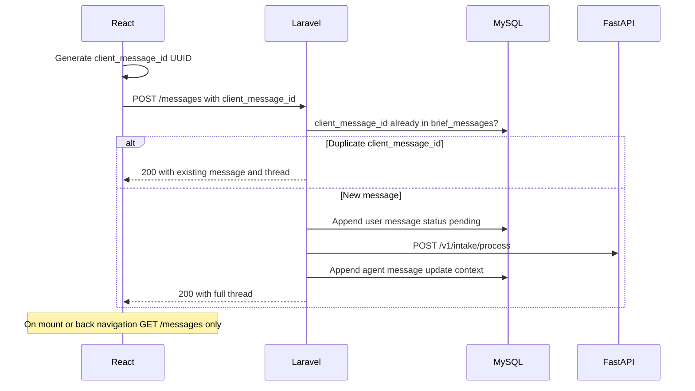
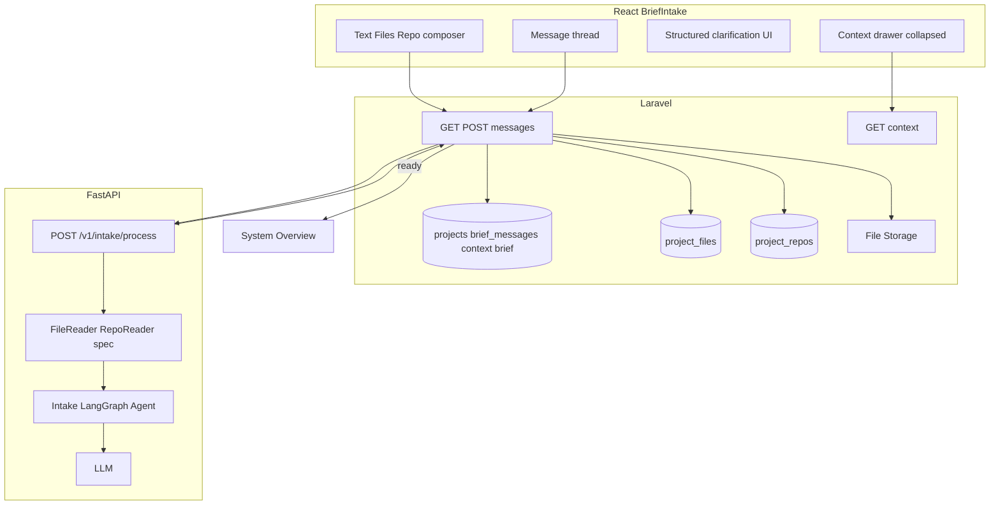
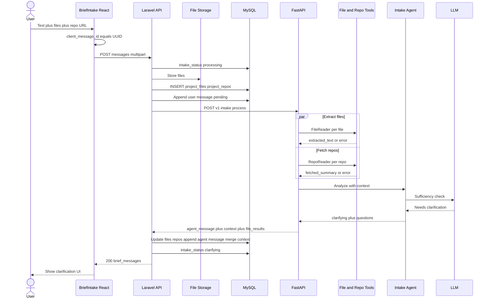
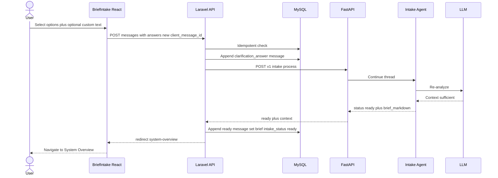
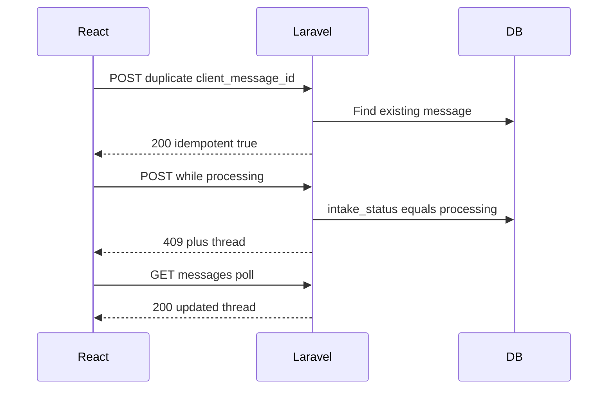

# Use Case Spec — UC-001: Flexible Project Brief Intake with AI Clarification

> **File:** `docs/v0.2/v0.2.1/use-cases/uc-001-flexible-brief-intake.md`

---

## 1. Header

| Field        | Value                                               |
| ------------ | --------------------------------------------------- |
| Use case ID  | `UC-001`                                            |
| Title        | Flexible Project Brief Intake with AI Clarification |
| Status       | Draft                                               |
| Priority     | P0                                                  |
| Owner        | Mohamed Thabet                                      |
| Last updated | 2026-05-17                                          |

---

## 2. Summary

A software engineer creates a new project in Sirius and opens the **Brief Intake** page (`/projects/{project}/brief-intake`) — a chat-style interface that replaces the legacy Prepare wizard (`Prepare.tsx`). The user provides project context as **free text**, **uploaded documents** (`.txt`, `.pdf`, `.docx`, `.md`), and/or **GitHub repository URLs**. Each turn is sent to Laravel via `POST /projects/{project}/messages`; Laravel persists the conversation in `projects.brief_messages` (JSON), forwards processing to FastAPI, and stores the agent-maintained knowledge base in `projects.context` (JSON).

After the first message, a LangGraph-powered intake agent analyzes all available context. If requirements are unclear, it responds with **structured clarification questions** embedded in the chat (single-select, multi-select, plus an optional free-text “other approach”; the agent marks one option as recommended). The user answers inline; each answer is another message. When the agent determines context is sufficient, it returns `status: ready`; Laravel writes a consolidated markdown snapshot to the legacy `brief` text column (for downstream System Overview generation) and redirects the user to `/projects/{project}/system-overview`.

**Replaces:** batch `POST /projects/brief`, `clarification_rounds` / `clarification_answers` tables as primary UX, and the guided Prepare questionnaire for new projects.

---

## 3. Actors and Context

### Primary Actor

**Software Engineer (User)** — the developer creating a new project in Sirius who wants to generate pre-code planning documentation.

### Secondary Actors

| Actor | Role |
| --- | --- |
| **React + Inertia.js** | Brief Intake chat UI, attachment composer, structured clarification controls, collapsible context panel |
| **Laravel Backend** | Auth, validation, file/repo persistence, `brief_messages` / `context` writes, FastAPI orchestration, idempotent message API |
| **FastAPI Service** | Intake agent orchestration; file/repo reading utilities (spec in v0.2.1; implementation deferred) |
| **LangGraph Intake Agent** | Analyzes context, emits clarification or `ready`; checkpointed by `project_id` |
| **LLM (Claude/GPT)** | Reasoning, question generation, context synthesis |
| **GitHub API** | Repo tree and priority file contents |
| **File Storage (S3/local)** | Uploaded file bytes via Laravel `Storage` |

> **Note:** MySQL is the **source of truth** for conversation and context. Redis is **not required** for intake session continuity. FastAPI may use SQLite LangGraph checkpoints (`thread_id = project_id`), consistent with existing chat controllers.

### Preconditions

- [x] User is authenticated and has an active session
- [x] User owns the project (or has policy-granted access)
- [x] FastAPI service is reachable from Laravel (`config('app.fastapi_base_url')`)
- [x] GitHub OAuth token is available when user links a private repo (see UC-010)

### Postconditions (success)

- [x] `projects.intake_status` = `ready`
- [x] `projects.brief_messages` contains the full user/agent thread
- [x] `projects.context` contains the consolidated knowledge base from the agent
- [x] `projects.brief` receives a markdown snapshot derived from `context` (backward compatibility with Overview pipeline)
- [x] Uploaded files are in storage with rows in `project_files`
- [x] Repo URLs are recorded in `project_repos` with fetch/extraction metadata
- [x] User is redirected to System Overview (`/projects/{project}/system-overview`)

### Postconditions (failure)

- [x] Failed file extraction: `project_files.extraction_status` = `extraction_failed`; intake continues with remaining context; user sees inline warning
- [x] Failed repo fetch: `project_repos.fetch_status` = `fetch_failed`; intake continues
- [x] FastAPI unreachable: user message remains in thread with `status: failed`; `intake_status` = `failed`; user can retry
- [x] Duplicate submit (double-click): idempotent response — no duplicate agent turns

---

## 4. Traceability

| Type | IDs / References |
| --- | --- |
| Functional requirements | `FR-001` (Project Creation), `FR-002` (Project Decomposition), `FR-003` (Documentation Generation) |
| Non-functional requirements | `NFR-001` (Response < 5s for file extraction start), `NFR-002` (Support files up to 20MB), `NFR-003` (GitHub API rate limit handling) |
| PRD | Sirius PRD v2 — Section 3: Brief Intake & Context Engine |
| Supersedes | Legacy Prepare wizard (`laravel/resources/js/pages/Projects/Prepare.tsx`) for **new** projects |
| Downstream | System Overview (`SystemOverviewController`, `/v1/Overview/generate`) |

---

## 5. User Journey (Happy Path)

1. **User creates** a project (`POST /projects`) with a name only.
2. **Laravel redirects** to `/projects/{project}/brief-intake` (not `/prepare`).
3. **User composes** first message: text and/or file(s) and/or GitHub repo URL(s) in the chat composer.
4. **React generates** `client_message_id` (UUID) and sends `POST /projects/{project}/messages` (multipart if files attached).
5. **Laravel** validates, stores files to storage + `project_files`, parses repos into `project_repos`, appends user message to `brief_messages` (`status: pending`), sets `intake_status` = `processing`, calls FastAPI `POST /v1/intake/process`.
6. **FastAPI** runs file/repo tools (when implemented), invokes intake agent with `brief_messages`, `context`, and attachment refs.
7. **Agent responds** with `status: clarifying` and a message `kind: clarification` containing structured questions.
8. **Laravel** appends agent message, merges `context`, sets `intake_status` = `clarifying`, returns full thread JSON.
9. **React renders** clarification UI inside the chat bubble (radio/checkbox groups, recommended badge on first option, optional textarea).
10. **User selects** answers and sends another `POST .../messages` with `answers` payload (new `client_message_id`).
11. **Steps 5–9 repeat** until agent returns `status: ready`.
12. **Laravel** appends `kind: ready` agent message, finalizes `context`, writes markdown to `brief`, sets `intake_status` = `ready`, returns `{ redirect: "/projects/{id}/system-overview" }`.
13. **React navigates** to System Overview; existing overview generation flow may auto-start (session flag or explicit generate call).

---

## 5b. Idempotency and Navigation

Duplicate clicks and back-navigation are handled **without** separate request/response audit tables. The database thread is the single source of truth.



| Layer | Mechanism |
| --- | --- |
| **React** | Generate `client_message_id` per send; disable composer while `isPending`; show optimistic `pending` bubble until server ack; on mount/route return call `GET /projects/{project}/messages` — **do not** treat `localStorage` as source of truth |
| **Laravel** | `BriefIntakeService::storeMessage()` checks `brief_messages` for matching `client_message_id`; if found, return cached thread + agent response; else process inside a DB transaction |
| **Concurrency** | While `intake_status` = `processing`, reject a second `POST` with **409 Conflict** and `{ intake_status, brief_messages }` so the client polls `GET` instead of firing duplicate agent runs |
| **FastAPI** | Stateless per HTTP request; receives full `brief_messages` slice + `context` + file/repo IDs; LangGraph `thread_id` = `project.id` |

This extends the append-and-persist pattern used by `SystemOverviewController::updateWithAi` (`overview_chat`) with explicit client-side deduplication keys.

---

## 6. Alternative and Error Flows

| # | Condition | Expected Behavior |
| - | --------- | ----------------- |
| A1 | User sends text only (no files, no repo) | Agent works with text; may still ask clarification |
| A2 | File extraction fails (corrupted PDF, password-protected DOCX) | `project_files.extraction_status` = `extraction_failed`; attachment shows `failed` in message; intake continues |
| A3 | Invalid or unauthorized GitHub repo URL | `project_repos.fetch_status` = `fetch_failed`; inline warning; intake continues |
| A4 | GitHub API rate limit | Retry with exponential backoff (3 attempts); then proceed without that repo |
| A5 | User double-clicks Send | Second request has same `client_message_id` → idempotent 200, no duplicate agent call |
| A6 | User navigates away and returns | `GET /messages` hydrates full thread from DB; clarification state restored |
| A7 | File exceeds 20MB | Laravel validation error before storage |
| A8 | Empty message (no text, files, or repos, and not a clarification answer) | React + Laravel validation reject |
| A9 | FastAPI unreachable | User message saved with `status: failed`; toast + retry affordance |
| A10 | Second POST while `intake_status` = `processing` | 409 + current thread; UI polls GET |
| A11 | Legacy project has `brief` text but empty `brief_messages` | Navigation skips Brief Intake; existing Overview/Prepare flows unchanged |

---

## 7. Data and Contracts

### 7a. Database Design

#### `projects` (additions / changes)

| Column | Type | Notes |
| --- | --- | --- |
| `id` | bigint PK | Existing |
| `user_id` | FK → users | Existing |
| `name` | varchar | Existing |
| `brief` | text, nullable | **Kept** — final markdown snapshot for Overview pipeline and legacy projects |
| `brief_messages` | json, nullable | **New** — ordered intake chat thread (see schema below) |
| `context` | json, nullable | **New** — agent-maintained project knowledge base |
| `intake_status` | varchar, nullable | **New** — `draft`, `processing`, `clarifying`, `ready`, `failed` |
| `intake_processing_at` | timestamp, nullable | **New** — optional lock timestamp for 409 concurrency guard |
| `status` | enum | Existing project lifecycle (`draft`, `in_progress`, …) — unchanged |
| `overview_chat` | json, nullable | Existing — separate from brief intake |
| `created_at`, `updated_at` | timestamps | Existing |

**Migration (implementers):**

- File: `laravel/database/migrations/YYYY_MM_DD_add_brief_intake_columns_to_projects_table.php`
- Adds after `brainstorming_scene`: `brief_messages` (json), `context` (json), `intake_status` (string, default `draft`), `intake_processing_at` (timestamp, nullable)
- Does **not** drop or alter existing `brief` column

**Model casts (`Project.php`):**

```php
'brief_messages' => 'array',
'context' => 'array',
```

#### `brief_messages` item schema

```json
{
  "id": "550e8400-e29b-41d4-a716-446655440000",
  "client_message_id": "660e8400-e29b-41d4-a716-446655440001",
  "role": "user",
  "kind": "text",
  "content": "We are building a marketplace for freelancers...",
  "attachments": [
    {
      "type": "file",
      "id": "01JFILE...",
      "name": "spec.pdf",
      "status": "processed"
    },
    {
      "type": "repo",
      "id": "01JREPO...",
      "name": "org/marketplace",
      "status": "processed"
    }
  ],
  "clarification": null,
  "answers": null,
  "status": "completed",
  "created_at": "2026-05-17T10:00:00Z"
}
```

**`kind` values:**

| kind | role | Description |
| --- | --- | --- |
| `text` | user | Free-text message |
| `attachments` | user | Primarily files/repos with optional short caption in `content` |
| `clarification` | agent | Structured questions in `clarification` object |
| `clarification_answer` | user | User reply; `answers` array populated |
| `ready` | agent | Intake complete; `content` may include summary message |
| `system` | system | Errors, retries, status notices |

**Clarification object (on agent messages):**

```json
{
  "questions": [
    {
      "id": "q1",
      "text": "Who are the primary users?",
      "selection_mode": "single",
      "recommended_option_id": "opt_a",
      "options": [
        { "id": "opt_a", "label": "Freelancers and clients" },
        { "id": "opt_b", "label": "Internal ops team only" }
      ],
      "allow_custom_text": true
    },
    {
      "id": "q2",
      "text": "Which platforms should v1 support?",
      "selection_mode": "multiple",
      "recommended_option_id": "opt_web",
      "options": [
        { "id": "opt_web", "label": "Web" },
        { "id": "opt_ios", "label": "iOS" },
        { "id": "opt_android", "label": "Android" }
      ],
      "allow_custom_text": true
    }
  ]
}
```

**Answers payload (on user messages replying to clarification):**

```json
{
  "answers": [
    {
      "question_id": "q1",
      "selected_option_ids": ["opt_a"],
      "custom_text": null
    },
    {
      "question_id": "q2",
      "selected_option_ids": ["opt_web", "opt_ios"],
      "custom_text": "PWA later in v2"
    }
  ],
  "in_reply_to_message_id": "agent-msg-uuid"
}
```

#### `context` schema

```json
{
  "version": 1,
  "summary": "B2B marketplace connecting freelancers and clients with escrow payments.",
  "requirements": [
    "User registration and profiles",
    "Project posting and bidding"
  ],
  "constraints": [
    "Must support Stripe",
    "GDPR-compliant data handling"
  ],
  "sources": [
    {
      "type": "file",
      "ref_id": "01JFILE...",
      "excerpt": "..."
    },
    {
      "type": "repo",
      "ref_id": "01JREPO...",
      "excerpt": "README summary..."
    },
    {
      "type": "user",
      "ref_id": "msg-uuid",
      "excerpt": "..."
    }
  ],
  "open_questions": [],
  "updated_at": "2026-05-17T10:05:00Z"
}
```

#### `project_files`

| Column | Type | Notes |
| --- | --- | --- |
| `id` | ULID PK | |
| `project_id` | FK → projects | |
| `brief_message_id` | varchar(36), nullable | Links file to originating message |
| `original_name` | varchar(255) | |
| `storage_path` | varchar(500) | S3/local path |
| `mime_type` | varchar(100) | |
| `file_size_bytes` | bigint | |
| `extraction_status` | enum | `pending`, `extracted`, `extraction_failed` |
| `extracted_text` | longtext, nullable | |
| `extraction_error` | text, nullable | |
| `created_at` | timestamp | |

#### `project_repos`

| Column | Type | Notes |
| --- | --- | --- |
| `id` | ULID PK | |
| `project_id` | FK → projects | |
| `brief_message_id` | varchar(36), nullable | Links repo to originating message |
| `repo_url` | varchar(500) | |
| `owner` | varchar(100) | Parsed |
| `repo_name` | varchar(100) | Parsed |
| `default_branch` | varchar(100), nullable | |
| `fetch_status` | enum | `pending`, `fetched`, `fetch_failed` |
| `fetched_summary` | longtext, nullable | |
| `fetch_error` | text, nullable | |
| `files_fetched_count` | int, default 0 | |
| `total_tokens_used` | int, default 0 | |
| `created_at` | timestamp | |

> **Deprecated for v0.2.1:** `clarification_rounds`, `clarification_answers` — clarification lives inside `brief_messages`.

---

### 7b. Key Reads / Writes

| Operation | Table(s) | Trigger |
| --- | --- | --- |
| Load thread | `projects.brief_messages`, `intake_status` | `GET .../messages` on page load |
| Send message | `brief_messages`, `project_files`, `project_repos` | `POST .../messages` |
| Update knowledge base | `projects.context` | After each successful FastAPI turn |
| Finalize brief | `projects.brief` | Agent `ready` |
| Set intake complete | `projects.intake_status` | Agent `ready` |
| File extraction result | `project_files` | FastAPI callback or inline in process response |
| Repo fetch result | `project_repos` | FastAPI callback or inline in process response |

---

### 7c. API Contracts (Laravel)

#### `GET /projects/{project}/messages`

**Response:**

```json
{
  "intake_status": "clarifying",
  "brief_messages": [ "...array of message objects..." ],
  "context_available": true,
  "project": { "id": 1, "name": "My App" }
}
```

#### `GET /projects/{project}/context` (optional)

Returns full `context` JSON for the side panel. Default page load may omit heavy context and fetch on panel open only.

#### `POST /projects/{project}/messages`

**Request (multipart when files present):**

```json
{
  "client_message_id": "660e8400-e29b-41d4-a716-446655440001",
  "content": "Here is our product idea and spec.",
  "files": ["<binary>"],
  "repo_urls": ["https://github.com/org/repo"],
  "answers": null,
  "in_reply_to_message_id": null
}
```

**Clarification answer request (JSON):**

```json
{
  "client_message_id": "770e8400-e29b-41d4-a716-446655440002",
  "kind": "clarification_answer",
  "in_reply_to_message_id": "agent-msg-uuid",
  "answers": [
    { "question_id": "q1", "selected_option_ids": ["opt_a"], "custom_text": null }
  ]
}
```

**Response (clarifying):**

```json
{
  "intake_status": "clarifying",
  "brief_messages": [ "..." ],
  "latest_agent_message_id": "..."
}
```

**Response (ready):**

```json
{
  "intake_status": "ready",
  "brief_messages": [ "..." ],
  "redirect": "/projects/1/system-overview"
}
```

**Response (duplicate — idempotent):**

```json
{
  "intake_status": "clarifying",
  "brief_messages": [ "..." ],
  "idempotent": true
}
```

**Response (concurrent processing — 409):**

```json
{
  "message": "Intake is already processing.",
  "intake_status": "processing",
  "brief_messages": [ "..." ]
}
```

#### Removed endpoints

| Endpoint | Status |
| --- | --- |
| `POST /projects/brief` | **Removed** |
| `POST /projects/brief/answers` | **Removed** — use `POST .../messages` |

---

### 7d. API Contracts (FastAPI)

#### `POST /v1/intake/process`

**Request:**

```json
{
  "project_id": 1,
  "brief_messages": [ "..." ],
  "context": { "version": 1, "summary": "..." },
  "file_ids": ["01JFILE..."],
  "repo_ids": ["01JREPO..."],
  "latest_user_message": { "kind": "text", "content": "..." }
}
```

**Response (clarifying):**

```json
{
  "status": "clarifying",
  "agent_message": {
    "kind": "clarification",
    "content": "I need a few details to shape the brief.",
    "clarification": { "questions": [ "..." ] }
  },
  "context": { "version": 1, "summary": "...", "updated_at": "..." },
  "file_results": [{ "id": "01JFILE...", "extraction_status": "extracted" }],
  "repo_results": [{ "id": "01JREPO...", "fetch_status": "fetched" }]
}
```

**Response (ready):**

```json
{
  "status": "ready",
  "agent_message": {
    "kind": "ready",
    "content": "I have enough context to proceed."
  },
  "context": { "..." },
  "brief_markdown": "# Project Brief\n\n..."
}
```

---

### 7e. External Integrations

| Integration | Purpose | Notes |
| --- | --- | --- |
| **GitHub REST API** | Repo tree + file contents | OAuth/PAT; rate limit handling per NFR-003 |
| **LangGraph** | Intake agent with `thread_id = project_id` | SQLite checkpoints in FastAPI (existing pattern) |
| **LLM** | Analysis, clarification, context merge | Claude/GPT via existing proxy |
| **S3 / Local Storage** | File bytes | Laravel `Storage` facade |
| **[mattpocock/skills](https://github.com/mattpocock/skills)** | Agent skill patterns | Reference for structured prompts and tool boundaries — not vendored into repo in v0.2.1 |

---

## 8. System Component Specifications

### 8a. React (Inertia.js)

| Item | Specification |
| --- | --- |
| **Page** | `laravel/resources/js/pages/Projects/BriefIntake.tsx` |
| **Route** | `GET /projects/{project}/brief-intake` → Inertia render |
| **Layout** | Full-height chat: message list (scroll) + fixed composer |
| **Composer** | Textarea + file dropzone (`.txt`, `.pdf`, `.docx`, `.md`, max 20MB) + repo URL chip input |
| **Message list** | Map `brief_messages`; user bubbles right, agent left; show attachment chips with status |
| **Clarification UI** | When `kind === 'clarification'`: render per-question control by `selection_mode` (`single` → radio, `multiple` → checkbox); highlight `recommended_option_id`; show “Other approach” textarea when `allow_custom_text`; disable Send until required selections made |
| **Context panel** | Collapsible `Sheet` / drawer (default **closed**); button “View context” loads `GET .../context` on first open |
| **State** | `useState` for draft composer only; thread from server props or GET; `client_message_id` via `crypto.randomUUID()` |
| **Submit guard** | `isPending` disables send; reuse `ChatInput` patterns from `components/Chat/ChatInput.tsx` where applicable |
| **Navigation** | Update `utils/project-navigation.ts`: if `brief_messages` empty and no legacy `brief` → `brief-intake`; if legacy `brief` exists → existing flow |
| **Deprecated** | `Prepare.tsx` remains for legacy projects only (not linked for new projects) |

### 8b. Laravel + Database

| Item | Specification |
| --- | --- |
| **Controller** | `App\Http\Controllers\Project\BriefMessageController` — `index()`, `store()`; optional `context()` |
| **Form request** | `StoreBriefMessageRequest` — validates `client_message_id` (uuid), content/attachments/answers rules |
| **Policy** | `ProjectPolicy::update` (owner) on all routes |
| **Service** | `App\Services\BriefIntakeService` — idempotency check, file/repo persistence, FastAPI HTTP call, transactional append to `brief_messages`, `context` merge, `brief` markdown on ready |
| **Routes** | `Route::get/post(...)` under `auth` + `project` middleware in `routes/web.php` |
| **Removed** | No `brief()` or `briefAnswers()` controller methods |
| **On ready** | Set `intake_status = ready`; write `brief` from `brief_markdown`; redirect URL in JSON; optional `session(['pending_overview_generation' => $id])` to match existing Overview behavior |
| **Jobs** | Optional `ProcessBriefAttachmentsJob` if extraction exceeds HTTP timeout — poll via GET until complete |
| **Best practices** | Slim controller; Form Request validation; Service for orchestration; `Http::fastapi()` with timeout/retry; model `$casts` for JSON columns |

### 8c. FastAPI — Agent and Tools

| Item | Specification |
| --- | --- |
| **Route** | Register `POST /v1/intake/process` in `fastAPI/src/routes/api_routes.py` |
| **Controller** | `intake_controller.py` — validate payload, call service |
| **Agent** | LangGraph graph: ingest → analyze → (clarify \| finalize context); use skill-style system prompts inspired by [mattpocock/skills](https://github.com/mattpocock/skills) for JSON-schema-bound clarification output |
| **Checkpointing** | `thread_id = project_id`; reuse SQLite checkpoint pattern from `chat_controller.py` |
| **Context merge** | Agent returns updated `context` object each turn; Laravel persists authoritative copy |
| **Tools (spec only — not implemented v0.2.1)** | See Section 8d |

### 8d. Tools (Specification Only — Not Implemented in v0.2.1)

#### FileReaderTool

| Concern | Detail |
| --- | --- |
| **Module** | `fastAPI/src/services/intake/file_reader.py` |
| **Inputs** | Storage path or bytes + mime type |
| **Formats** | `.pdf` (PyMuPDF), `.docx` (docx2txt), `.txt`, `.md` (UTF-8) |
| **Output** | `{ text, page_count?, error? }` |
| **Limits** | 20MB per file; truncate to token budget slice |

#### RepoReaderTool

| Concern | Detail |
| --- | --- |
| **Module** | `fastAPI/src/services/intake/repo_reader.py` |
| **Inputs** | `owner`, `repo`, GitHub token |
| **Steps** | Fetch tree → prioritize README, dependency manifests, schema/migration files → fetch within token budget |
| **Output** | `{ summary, files_fetched_count, tokens_used, error? }` |

#### Agent tool wiring (future)

- Agent invokes tools during `POST /v1/intake/process` before LLM analysis
- Failed tool results are non-fatal; passed to agent as partial context

---

## 9. Architecture Diagram



---

## 10. Sequence Diagrams

### 10a. First message with attachments



### 10b. Clarification answer and intake complete



### 10c. Idempotency and 409 branches



---

## 11. Acceptance Criteria (Testable)

- [ ] **GIVEN** a new project with empty `brief_messages` **WHEN** the user opens the project **THEN** they are routed to `/brief-intake` (not Prepare)
- [ ] **GIVEN** a user sends text only **WHEN** the agent processes **THEN** `brief_messages` contains user and agent entries and `intake_status` is `clarifying` or `ready`
- [ ] **GIVEN** a valid PDF upload **WHEN** extraction succeeds **THEN** `project_files.extraction_status` = `extracted` and attachment `status` = `processed`
- [ ] **GIVEN** a corrupted PDF **WHEN** extraction fails **THEN** `extraction_status` = `extraction_failed` and intake continues
- [ ] **GIVEN** a valid public GitHub URL **WHEN** fetch succeeds **THEN** `project_repos.fetch_status` = `fetched` and `fetched_summary` is non-empty
- [ ] **GIVEN** agent emits clarification **WHEN** rendered **THEN** single-select uses radios, multi-select uses checkboxes, recommended option is visually distinct, custom textarea is available
- [ ] **GIVEN** the user double-submits with the same `client_message_id` **WHEN** the second POST arrives **THEN** response is 200 with `idempotent: true` and no duplicate agent message
- [ ] **GIVEN** `intake_status` is `processing` **WHEN** a second distinct POST arrives **THEN** Laravel returns 409 and the thread is unchanged except for the first pending message
- [ ] **GIVEN** the user navigates away mid-clarification **WHEN** they return to brief-intake **THEN** `GET /messages` restores the full thread from DB
- [ ] **GIVEN** agent returns `ready` **WHEN** Laravel finalizes **THEN** `intake_status` = `ready`, `brief` is populated, redirect points to system-overview
- [ ] **GIVEN** a legacy project with `brief` text and no `brief_messages` **WHEN** opened **THEN** existing navigation (Overview/Prepare) is unchanged
- [ ] **GIVEN** context panel default state **WHEN** page loads **THEN** context drawer is closed; opening it fetches `GET /context`

---

## 12. Out of Scope (This Use Case Only)

- Implementing `FileReaderTool` / `RepoReaderTool` Python code (specified only)
- Vendoring [mattpocock/skills](https://github.com/mattpocock/skills) into the repository
- Removing `Prepare.tsx` or migrating legacy projects automatically
- Planning pipeline after intake (PRD, ERD, etc.) — **UC-002**
- GitHub OAuth connection flow — **UC-010**
- Team collaboration on the same intake thread — **UC-006**
- Billing / usage metering for intake API calls
- Non-GitHub repositories (GitLab, Bitbucket)
- Server-Sent Events / WebSocket streaming of agent tokens (loading state only in v0.2.1)
- Support for file formats beyond `.txt`, `.pdf`, `.docx`, `.md`

---

## 13. Open Questions

- Should `ready` auto-trigger `POST /system-overview/generate-async` or require an explicit user action on System Overview?
- Maximum total token budget for `context` + attachments before truncation strategy kicks in? (Suggested: 32K input tokens.)
- Should `context` and uploaded files be encrypted at rest?
- Permanent retention of `project_files` after `brief` snapshot is written, or lifecycle cleanup job?
- Maximum number of clarification turns before forced `ready` with `low_confidence` flag?
- Should failed messages be editable/resendable in-place or only via a new message?
