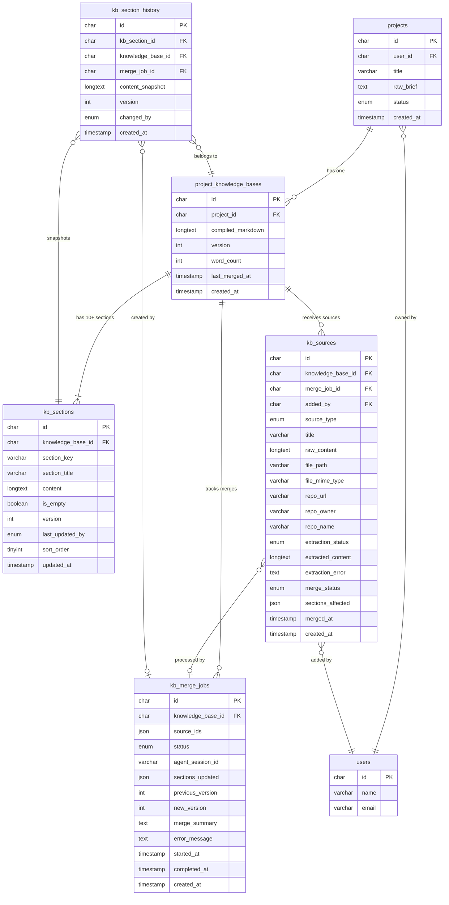
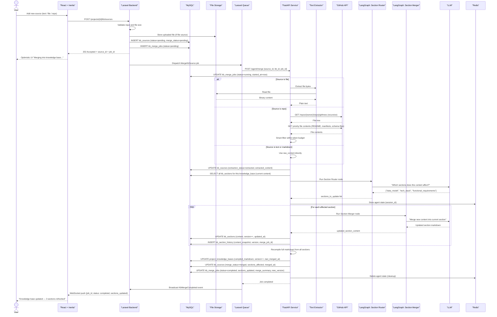
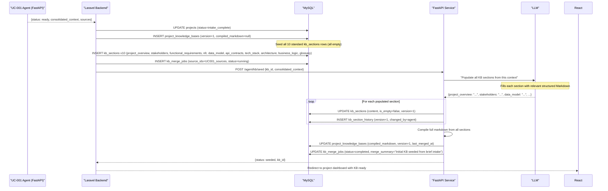

# Use Case Spec — UC-002: Project Knowledge Base

> **File:** `docs/use-cases/UC-002-project-knowledge-base.md`

---

## 1. Header

| Field        | Value                                      |
| ------------ | ------------------------------------------ |
| Use case ID  | `UC-002`                                   |
| Title        | Project Knowledge Base — Build, Maintain & Query |
| Status       | Draft                                      |
| Priority     | P0                                         |
| Owner        | Mohamed Thabet                             |
| Last updated | 2025-01-01                                 |
| Depends on   | `UC-001` (Flexible Brief Intake)           |

---

## 2. Summary

After a project brief is submitted and processed (UC-001), Sirius automatically creates a **Project Knowledge Base (KB)** — a living, structured document that becomes the single source of truth for all AI-generated artifacts (PRD, Use Cases, ERD, API Spec, Architecture, Technical Spec). The KB is stored in the database as both **sectioned records** (one row per knowledge domain) and a **compiled Markdown document** (the full merged output). At any point after creation, the engineer can enrich the KB by adding new raw sources — plain text, Markdown snippets, uploaded files (`.txt`, `.pdf`, `.docx`), or GitHub repository URLs. When a new source is added, a LangGraph AI agent extracts its content, routes it to the relevant KB sections, and merges the new knowledge into each section without losing or duplicating existing information. Every change is versioned at the section level, giving a full audit trail of how the KB evolved.

---

## 3. Actors and Context

### Primary Actor
**Software Engineer (User)** — creates a project, receives the initial KB from UC-001, and enriches it over time by adding new sources.

### Secondary Actors

| Actor | Role |
|---|---|
| **Laravel Backend** | Validates input, persists sources, dispatches async merge jobs, owns all DB writes |
| **FastAPI Service** | Orchestrates extraction and hosts the LangGraph merge agent |
| **LangGraph Agent** | Two-node pipeline: Section Router + Section Merger |
| **LLM (Claude / GPT)** | Powers routing decisions and section rewriting |
| **File Storage (S3/local)** | Stores uploaded file binaries |
| **GitHub API** | Provides repo file tree and priority file contents |
| **Redis** | Holds serialized LangGraph agent state during async merge |
| **Artifact Generators** | Downstream consumers of KB sections (UC-003+) |

### Preconditions
- [x] UC-001 has completed successfully — a `projects` record exists with `status = intake_complete`
- [x] User is authenticated and owns/has access to this project
- [x] FastAPI service is reachable
- [x] Redis is running

### Postconditions (success — initial KB creation)
- [x] A `project_knowledge_bases` record is created and linked to the project
- [x] All 10 standard `kb_sections` rows are seeded (most initially empty)
- [x] All intake sources from UC-001 are migrated as `kb_sources` records and merged
- [x] `compiled_markdown` is populated with the initial KB
- [x] `kb_merge_jobs` records the initial seed merge

### Postconditions (success — add new source)
- [x] New `kb_sources` record created with `merge_status = merged`
- [x] Affected `kb_sections` rows updated with merged content and incremented version
- [x] A `kb_section_history` snapshot is written for each changed section
- [x] `compiled_markdown` recompiled and `project_knowledge_bases.version` incremented
- [x] `kb_merge_jobs` record completed with `sections_updated` and `merge_summary`

### Postconditions (failure)
- [x] Source marked `extraction_failed` or `merge_status = failed`
- [x] KB remains at its last valid state — no partial writes
- [x] `kb_merge_jobs.status = failed` with `error_message` populated
- [x] User notified with actionable error (e.g., "Could not read PDF — try re-uploading")

---

## 4. Traceability

| Type | IDs / References |
|---|---|
| Functional requirements | `FR-001` (Project Creation), `FR-003` (Documentation Generation), `FR-005` (ERD Aggregation) |
| Non-functional requirements | `NFR-001` (Merge completes < 30s for typical source), `NFR-004` (Section history retained indefinitely), `NFR-005` (No data loss on failed merge) |
| Depends on | `UC-001` — Brief intake sources are migrated into KB on project creation |
| Consumed by | `UC-003` (PRD Generation), `UC-004` (ERD Generation), `UC-005` (API Spec Generation), `UC-006` (Architecture Doc Generation) |

---

## 5. Architecture

The KB system has three layers: the **input layer** (any source type), the **processing layer** (extraction + LangGraph merge agent), and the **storage layer** (sectioned + compiled in MySQL).

```
┌─────────────────────── INPUT LAYER ───────────────────────────┐
│                                                                │
│   Plain Text    Markdown    File Upload     GitHub Repo        │
│   (textarea)    (editor)    (.pdf .docx     (URL input)        │
│                              .txt)                             │
└──────────────────────────┬────────────────────────────────────┘
                           │  POST /kb/sources
                           ▼
┌─────────────────── LARAVEL BACKEND ───────────────────────────┐
│  Validate → Store file → INSERT kb_sources (status=pending)   │
│  Dispatch async job → Return optimistic response to React     │
└──────────────────────────┬────────────────────────────────────┘
                           │  HTTP POST /agent/merge
                           ▼
┌─────────────────── FASTAPI SERVICE ───────────────────────────┐
│                                                                │
│  ┌─────────────────────────────────────────────────────────┐  │
│  │                  EXTRACTION LAYER                        │  │
│  │  PyMuPDFLoader │ Docx2txtLoader │ TextLoader │ GitHubFL  │  │
│  └───────────────────────┬─────────────────────────────────┘  │
│                          │ extracted_content                   │
│  ┌───────────────────────▼─────────────────────────────────┐  │
│  │               LANGGRAPH MERGE AGENT                      │  │
│  │                                                          │  │
│  │  Node 1: Section Router                                  │  │
│  │    "Which sections does this affect?"                    │  │
│  │    Input:  extracted_content                             │  │
│  │    Output: ["data_model", "tech_stack"]                  │  │
│  │                          │                               │  │
│  │  Node 2: Section Merger (runs per affected section)      │  │
│  │    "Merge new info into current section content"         │  │
│  │    Input:  current_section + extracted_content           │  │
│  │    Output: updated section markdown                      │  │
│  └───────────────────────┬─────────────────────────────────┘  │
└──────────────────────────┼────────────────────────────────────┘
                           │  Updated sections + merge summary
                           ▼
┌─────────────────── STORAGE LAYER (MySQL) ─────────────────────┐
│                                                                │
│  kb_sections (updated rows)                                    │
│  kb_section_history (new snapshot per changed section)         │
│  kb_merge_jobs (status=completed, sections_updated)            │
│  kb_sources (merge_status=merged, sections_affected)           │
│  project_knowledge_bases (compiled_markdown recompiled,        │
│                            version++)                          │
└────────────────────────────────────────────────────────────────┘
```

---

## 6. Entity Relationship Diagram



---

## 7. Sequence Diagram — Add New Source & Merge



---

## 8. Sequence Diagram — Initial KB Creation (from UC-001 output)



---

## 9. User Journey — Adding a New Source (Happy Path)

1. **User opens** the project Knowledge Base tab in Sirius.
2. **User sees** the current KB rendered as structured sections (Overview, Data Model, etc.) with a version badge ("v4").
3. **User clicks** "+ Add Source" — a panel slides open with four tabs: Text, Markdown, File, Repo.
4. **User picks "File"** and drags in a new `api-contracts-v2.pdf`.
5. **User optionally titles it** "API Contracts v2" and clicks "Add to KB".
6. **React sends** `POST /projects/{id}/kb/sources` with the file attached.
7. **Laravel** validates, stores the file, inserts `kb_sources` and `kb_merge_jobs` records, dispatches the async queue job.
8. **Laravel returns 202** — React shows an inline loading state on the KB with "Merging API Contracts v2...".
9. **FastAPI** extracts text from the PDF, reads current `api_contracts` and `data_model` sections, runs the Section Router (identifies those two sections), runs the Section Merger for each.
10. **DB updated** — both sections rewritten, history snapshots created, compiled markdown recompiled, version bumped to v5.
11. **WebSocket event** fires — React updates the KB view in real-time.
12. **User sees** the `api_contracts` section now reflects the new endpoints, and a diff badge shows "2 sections updated".

---

## 10. Alternative and Error Flows

| # | Condition | Expected Behavior |
|---|---|---|
| A1 | User adds plain text that is already covered by the KB | Agent merges and deduplicates; no duplicate content written; `merge_summary` notes "No net changes to data_model" |
| A2 | New source contradicts existing KB content | Agent applies new content and overwrites — new info wins; contradiction logged in `merge_summary` |
| A3 | File extraction fails (corrupted PDF) | `kb_sources.extraction_status = extraction_failed`; `kb_merge_jobs.status = failed`; KB unchanged; user notified |
| A4 | GitHub API rate limit hit | Retry with exponential backoff ×3; if still failing, source marked `fetch_failed`; KB unchanged |
| A5 | LLM call fails mid-merge (e.g., timeout on Section Merger) | Transaction rolled back; no partial section writes; `kb_merge_jobs.status = failed`; source stays `merge_status = pending` for retry |
| A6 | User manually edits a section in the UI | `kb_sections.last_updated_by = user`; history snapshot written; `compiled_markdown` recompiled; no merge job created |
| A7 | User adds a custom section | `section_key = custom:{slug}`; treated identically to standard sections for all merge and history operations |
| A8 | Source is added while a merge is already running | Second job queued; runs after first completes; no concurrent writes to same section |
| A9 | User wants to undo a merge | UI shows section history; user can restore any snapshot; triggers a new history entry with `changed_by = user` |

---

## 11. Data and Contracts

### 11a. Standard KB Sections (seeded on every project KB)

| `section_key` | Purpose | Key artifact consumer |
|---|---|---|
| `project_overview` | Purpose, goals, problem statement, target market | PRD intro, pitch doc |
| `stakeholders` | User types, roles, personas | Use cases, PRD |
| `functional_requirements` | Features, user stories, acceptance criteria | PRD, use cases |
| `non_functional_requirements` | Performance, security, scalability, compliance | Tech spec |
| `data_model` | Entities, attributes, relationships, constraints | ERD, DB design, API spec |
| `api_contracts` | Endpoints, request/response shapes, auth model | API spec, sequence diagrams |
| `tech_stack` | Chosen technologies and rationale | Architecture doc, tech spec |
| `architecture` | System components, deployment model, integrations | Architecture doc |
| `business_logic` | Rules, workflows, edge cases, calculations | Use cases, tech spec |
| `glossary` | Domain terms and definitions | All artifacts |

### 11b. API Contracts (Laravel)

**Add a source:**
```
POST /projects/{project_id}/kb/sources
Content-Type: multipart/form-data

{
  "source_type": "file",           // text | markdown | file | repo
  "title": "API Contracts v2",
  "file": <binary>,                // for source_type=file
  "raw_content": "...",            // for source_type=text|markdown
  "repo_url": "https://..."        // for source_type=repo
}

Response 202:
{
  "source_id": "01J...",
  "merge_job_id": "01J...",
  "status": "pending"
}
```

**Get KB with sections:**
```
GET /projects/{project_id}/kb

Response 200:
{
  "id": "01J...",
  "version": 5,
  "last_merged_at": "2025-01-01T12:00:00Z",
  "sections": [
    {
      "section_key": "data_model",
      "section_title": "Data Model",
      "content": "## Entities\n...",
      "version": 3,
      "is_empty": false,
      "last_updated_by": "agent"
    }
  ],
  "sources_count": 7,
  "compiled_markdown_url": "/projects/{id}/kb/export"
}
```

**Get section history:**
```
GET /projects/{project_id}/kb/sections/{section_key}/history

Response 200:
{
  "section_key": "data_model",
  "history": [
    { "version": 3, "changed_by": "agent", "merge_job_id": "01J...", "created_at": "..." },
    { "version": 2, "changed_by": "user", "merge_job_id": null, "created_at": "..." },
    { "version": 1, "changed_by": "agent", "merge_job_id": "01J...", "created_at": "..." }
  ]
}
```

**Restore a section version:**
```
POST /projects/{project_id}/kb/sections/{section_key}/restore
{ "version": 2 }
```

### 11c. External Integrations

| Integration | Purpose | Notes |
|---|---|---|
| **GitHub REST API** | Fetch repo tree + priority files for repo sources | Same strategy as UC-001: README, manifests, schema files first |
| **PyMuPDFLoader** | PDF extraction | `pip install pymupdf` |
| **Docx2txtLoader** | DOCX extraction | `pip install docx2txt` |
| **LangGraph** | Two-node agent: Section Router + Section Merger | Stateless per merge job (no Redis needed for typical merges) |
| **LLM** | Powers routing and section rewriting | Claude Sonnet recommended — good at structured Markdown output |
| **Redis** | Agent state for long-running merges (large repos) | Optional; only needed if merge spans multiple HTTP request cycles |
| **WebSockets (Pusher / Reverb)** | Real-time KB update notifications to React | Broadcast `KbMergeCompleted` event after job finishes |

---

## 12. Acceptance Criteria (Testable)

- [ ] **GIVEN** UC-001 completes **WHEN** KB is seeded **THEN** all 10 standard sections exist in `kb_sections` and `compiled_markdown` is non-null
- [ ] **GIVEN** a user adds a `.pdf` file source **WHEN** extraction succeeds **THEN** `kb_sources.extraction_status = extracted` and `extracted_content` is non-empty
- [ ] **GIVEN** a new source is added **WHEN** the Section Router runs **THEN** `kb_sources.sections_affected` contains only the sections actually relevant to the content (not all 10)
- [ ] **GIVEN** Section Merger runs for `data_model` **WHEN** the merge completes **THEN** `kb_sections` row is updated AND a `kb_section_history` snapshot is written with the previous content
- [ ] **GIVEN** a merge job completes **WHEN** checking `project_knowledge_bases` **THEN** `version` is incremented by 1 and `compiled_markdown` contains all updated section content
- [ ] **GIVEN** the LLM call fails mid-merge **WHEN** the error is caught **THEN** no partial section updates are written and `kb_merge_jobs.status = failed`
- [ ] **GIVEN** two sources are added simultaneously **WHEN** both merge jobs run **THEN** they are queued and execute sequentially — no race condition on `kb_sections`
- [ ] **GIVEN** a user manually edits a section **WHEN** saved **THEN** `last_updated_by = user` and a `kb_section_history` entry is created
- [ ] **GIVEN** a user restores a previous section version **THEN** the section content matches the snapshot and a new history entry is written
- [ ] **GIVEN** the KB reaches v5 **WHEN** an artifact generator (UC-003+) calls the API **THEN** it receives only the sections it requests, not the full `compiled_markdown`

---

## 13. Out of Scope (This Use Case Only)

- Generating any artifact from the KB (PRD, ERD, API Spec, etc.) — covered in UC-003 through UC-007
- Real-time collaborative editing of KB sections by multiple users simultaneously
- Semantic search / RAG across the KB (vector embeddings) — future enhancement
- KB sharing across projects (templates or cloning)
- Exporting the KB to external formats (Notion, Confluence, PDF) — future enhancement
- GitHub webhook integration (auto-update KB when repo changes)
- Fine-tuning or custom model training on KB data

---

## 14. Open Questions

- **Merge concurrency:** Should concurrent merge jobs be queued strictly (FIFO per KB), or is section-level locking sufficient? Section locking is more performant but adds implementation complexity.
- **Token budget for Section Merger:** What is the max token input per section merge call? Need to define ceiling to handle very large existing sections + large new sources.
- **Contradiction handling:** When new content directly contradicts the KB, should the agent flag it for user review rather than silently overwriting? A "conflict" state on `kb_merge_jobs` could surface this.
- **Manual edit + agent merge interaction:** If a user manually edits `data_model` then a new source is added that affects `data_model`, does the agent respect the manual edits or overwrite them? Suggested: treat `last_updated_by = user` sections as higher priority; agent adds to them rather than rewriting.
- **Compiled markdown format:** Should section headings in `compiled_markdown` use H2 (`##`) or H1 (`#`)? Needs to be standardized for all downstream artifact generators.
- **Custom section routing:** When the Section Router sees content that could fit a custom section, can it suggest creating a new custom section rather than forcing it into a standard one?