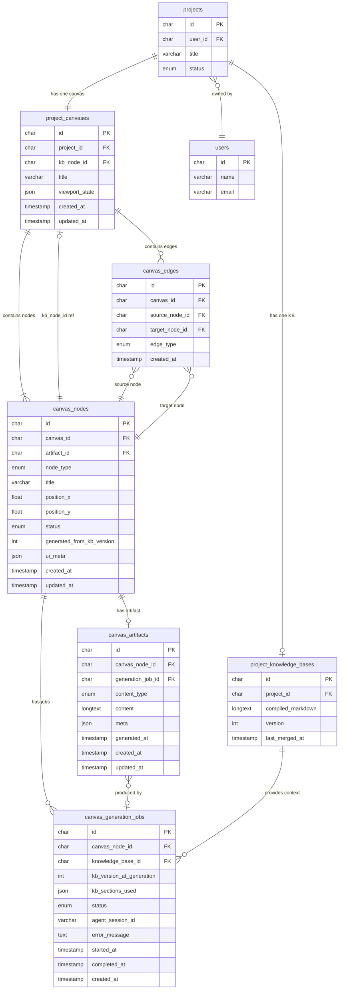
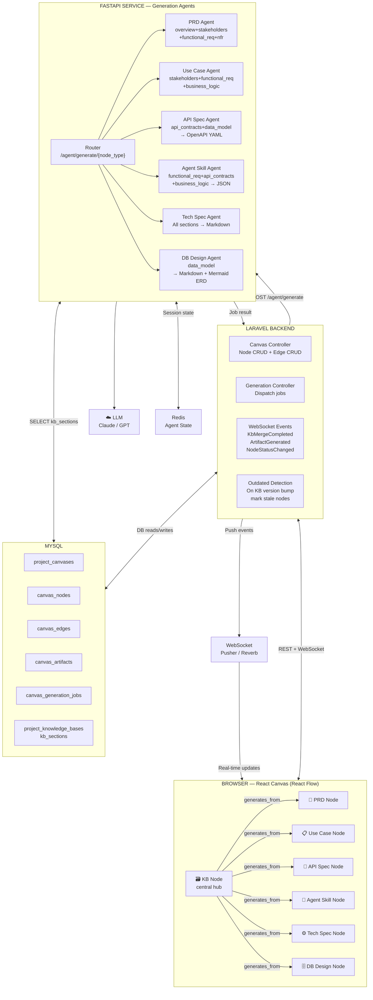
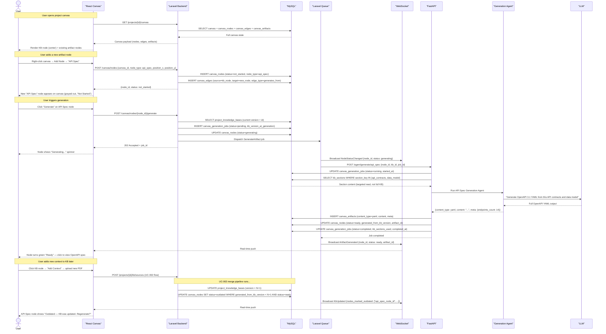
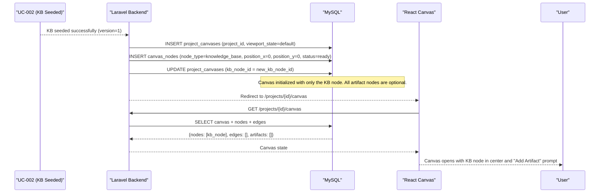

# Use Case Spec — UC-003: Project Canvas

> **File:** `docs/use-cases/UC-003-project-canvas.md`

---

## 1. Header

| Field        | Value                                                     |
| ------------ | --------------------------------------------------------- |
| Use case ID  | `UC-003`                                                  |
| Title        | Project Canvas — Knowledge Base Hub & Artifact Generation |
| Status       | Draft                                                     |
| Priority     | P0                                                        |
| Owner        | Mohamed Thabet                                            |
| Last updated | 2025-01-01                                                |
| Depends on   | `UC-001` (Brief Intake), `UC-002` (Knowledge Base)        |

---

## 2. Summary

The Project Canvas is the primary workspace of Sirius after a project is created. It is a **node-based visual interface** where the **Knowledge Base (KB) sits at the center** as the single source of truth, and all project artifacts — PRD, Use Cases, API Specs, Agent Skills, Tech Specs, and Database Design — are represented as **optional, user-controlled nodes** connected to the KB. The user can add any combination of artifact nodes, generate their content from the KB at any time, enrich the KB by adding new context sources directly on the canvas, and see which artifacts are outdated when the KB is updated. The schema is designed to be fully extensible — new artifact types can be added without touching existing tables.

---

## 3. Actors and Context

### Primary Actor
**Software Engineer (User)** — interacts with the canvas to manage the KB, generate docs, and track project documentation state.

### Secondary Actors

| Actor | Role |
|---|---|
| **Laravel Backend** | Node/edge CRUD, generation job dispatch, WebSocket events |
| **FastAPI Service** | Hosts one generation agent per artifact type |
| **LangGraph Agents** | Per-type agents that read KB sections and produce artifact content |
| **LLM** | Powers artifact content generation |
| **React Canvas (React Flow)** | Renders the interactive node graph in the browser |
| **WebSocket (Pusher/Reverb)** | Pushes generation status updates to the canvas in real time |
| **Redis** | Agent state for long-running generation jobs |

### Preconditions
- [x] UC-001 completed — project exists with `status = intake_complete`
- [x] UC-002 completed — `project_knowledge_bases` record exists with at least v1
- [x] A `project_canvases` record has been auto-created with one `canvas_nodes` row of type `knowledge_base`
- [x] User is authenticated and owns the project

### Postconditions (success — add artifact node)
- [x] A new `canvas_nodes` row exists with `node_type = {chosen_type}` and `status = not_started`
- [x] A `canvas_edges` row connects the KB node to the new artifact node
- [x] The canvas renders the new node at the chosen or auto-positioned location

### Postconditions (success — generate artifact)
- [x] `canvas_generation_jobs` record exists with `status = completed`
- [x] `canvas_artifacts` record created with full generated content
- [x] `canvas_nodes.status = ready` and `generated_from_kb_version` set to current KB version
- [x] All other nodes generated from an older KB version show `status = outdated`

### Postconditions (failure — generation)
- [x] `canvas_generation_jobs.status = failed` with `error_message`
- [x] `canvas_nodes.status = failed`; artifact content unchanged
- [x] User can retry generation without losing existing content

---

## 4. Traceability

| Type | IDs / References |
|---|---|
| Functional requirements | `FR-003` (Documentation Generation), `FR-004` (Code Prompt Generation), `FR-005` (ERD Aggregation) |
| Non-functional requirements | `NFR-006` (Canvas renders < 1s for ≤ 50 nodes), `NFR-007` (Generation completes < 60s per artifact) |
| Depends on | `UC-001`, `UC-002` |
| Downstream | Artifact export, GitHub push (`UC-007`), team collaboration (`UC-006`) |

---

## 5. Canvas Node Types

| `node_type` | Title | KB Sections Read | Output Format |
|---|---|---|---|
| `knowledge_base` | Knowledge Base | — (is the source) | Markdown (sectioned) |
| `prd` | Product Requirements Document | `project_overview` + `stakeholders` + `functional_requirements` + `nfr` | Markdown |
| `use_case` | Use Case Spec | `stakeholders` + `functional_requirements` + `business_logic` | Markdown (UC template) |
| `api_spec` | API Specification | `api_contracts` + `data_model` | YAML (OpenAPI 3.1) |
| `agent_skill` | Agent Skill Definition | `functional_requirements` + `api_contracts` + `business_logic` | JSON (skill schema) |
| `tech_spec` | Technical Specification | All sections | Markdown |
| `database_design` | Database Design & ERD | `data_model` | Markdown + Mermaid ERD |

> **Extensibility:** New node types are added to the `node_type` enum and a corresponding FastAPI generation endpoint. No other schema changes needed.

---

## 6. Entity Relationship Diagram



---

## 7. Full Database Schema

```sql
-- ─────────────────────────────────────────────────────
-- 1. Canvas root — one per project
-- ─────────────────────────────────────────────────────
CREATE TABLE project_canvases (
    id              CHAR(26) PRIMARY KEY,
    project_id      CHAR(26) NOT NULL UNIQUE REFERENCES projects(id),
    kb_node_id      CHAR(26) NULL,               -- FK set after KB node created (circular ref handled post-insert)
    title           VARCHAR(255) DEFAULT 'Project Canvas',
    viewport_state  JSON,                         -- {zoom, pan_x, pan_y} — last user viewport position
    created_at      TIMESTAMP DEFAULT CURRENT_TIMESTAMP,
    updated_at      TIMESTAMP DEFAULT CURRENT_TIMESTAMP ON UPDATE CURRENT_TIMESTAMP
);

-- ─────────────────────────────────────────────────────
-- 2. Canvas nodes — one row per node (KB node + all artifact nodes)
-- ─────────────────────────────────────────────────────
CREATE TABLE canvas_nodes (
    id                          CHAR(26) PRIMARY KEY,
    canvas_id                   CHAR(26) NOT NULL REFERENCES project_canvases(id),
    artifact_id                 CHAR(26) NULL REFERENCES canvas_artifacts(id),
    node_type                   ENUM(
                                    'knowledge_base',
                                    'prd',
                                    'use_case',
                                    'api_spec',
                                    'agent_skill',
                                    'tech_spec',
                                    'database_design'
                                ) NOT NULL,
    title                       VARCHAR(255) NOT NULL,   -- User can rename: "Auth Module Use Case"
    position_x                  FLOAT NOT NULL DEFAULT 0,
    position_y                  FLOAT NOT NULL DEFAULT 0,
    status                      ENUM(
                                    'not_started',
                                    'generating',
                                    'ready',
                                    'outdated',          -- KB updated after this artifact was generated
                                    'failed'
                                ) DEFAULT 'not_started',
    generated_from_kb_version   INT UNSIGNED NULL,       -- KB version when this artifact was last generated
    ui_meta                     JSON,                    -- {color, icon, collapsed, width, height}
    created_at                  TIMESTAMP DEFAULT CURRENT_TIMESTAMP,
    updated_at                  TIMESTAMP DEFAULT CURRENT_TIMESTAMP ON UPDATE CURRENT_TIMESTAMP,

    INDEX idx_canvas (canvas_id),
    INDEX idx_status (status),
    INDEX idx_type (node_type)
);

-- ─────────────────────────────────────────────────────
-- 3. Canvas edges — connections between nodes
-- ─────────────────────────────────────────────────────
CREATE TABLE canvas_edges (
    id              CHAR(26) PRIMARY KEY,
    canvas_id       CHAR(26) NOT NULL REFERENCES project_canvases(id),
    source_node_id  CHAR(26) NOT NULL REFERENCES canvas_nodes(id),
    target_node_id  CHAR(26) NOT NULL REFERENCES canvas_nodes(id),
    edge_type       ENUM('generates_from', 'depends_on') DEFAULT 'generates_from',
    created_at      TIMESTAMP DEFAULT CURRENT_TIMESTAMP,

    UNIQUE KEY uq_edge (source_node_id, target_node_id),
    INDEX idx_canvas (canvas_id)
);

-- ─────────────────────────────────────────────────────
-- 4. Artifacts — the generated content for each node
-- ─────────────────────────────────────────────────────
CREATE TABLE canvas_artifacts (
    id                  CHAR(26) PRIMARY KEY,
    canvas_node_id      CHAR(26) NOT NULL UNIQUE REFERENCES canvas_nodes(id),
    generation_job_id   CHAR(26) NULL REFERENCES canvas_generation_jobs(id),
    content_type        ENUM('markdown', 'yaml', 'json') NOT NULL,
    content             LONGTEXT NOT NULL,           -- Full artifact content
    meta                JSON,                        -- Type-specific: {uc_id, openapi_version, skill_name, ...}
    generated_at        TIMESTAMP NULL,
    created_at          TIMESTAMP DEFAULT CURRENT_TIMESTAMP,
    updated_at          TIMESTAMP DEFAULT CURRENT_TIMESTAMP ON UPDATE CURRENT_TIMESTAMP
);

-- meta examples per node_type:
-- prd:              {"word_count": 3200}
-- use_case:         {"uc_id": "UC-003", "priority": "P0", "story_points": 8}
-- api_spec:         {"openapi_version": "3.1.0", "endpoints_count": 14}
-- agent_skill:      {"skill_name": "search_knowledge_base", "parameters_count": 3}
-- tech_spec:        {"sections": ["overview","stack","deployment","monitoring"]}
-- database_design:  {"tables_count": 12, "has_erd": true}

-- ─────────────────────────────────────────────────────
-- 5. Generation jobs — one per generate action per node
-- ─────────────────────────────────────────────────────
CREATE TABLE canvas_generation_jobs (
    id                      CHAR(26) PRIMARY KEY,
    canvas_node_id          CHAR(26) NOT NULL REFERENCES canvas_nodes(id),
    knowledge_base_id       CHAR(26) NOT NULL REFERENCES project_knowledge_bases(id),
    kb_version_at_generation INT UNSIGNED NOT NULL,  -- Snapshot of KB version used
    kb_sections_used        JSON NOT NULL,            -- ["data_model", "api_contracts"]
    status                  ENUM('pending','running','completed','failed') DEFAULT 'pending',
    agent_session_id        VARCHAR(100),
    error_message           TEXT,
    started_at              TIMESTAMP NULL,
    completed_at            TIMESTAMP NULL,
    created_at              TIMESTAMP DEFAULT CURRENT_TIMESTAMP,

    INDEX idx_node (canvas_node_id),
    INDEX idx_kb (knowledge_base_id),
    INDEX idx_status (status)
);
```

---

## 8. Architecture



---

## 9. Sequence Diagram — Add Node & Generate Artifact



---

## 10. Sequence Diagram — Canvas Initial Setup (from UC-002 output)



---

## 11. Outdated Detection Logic

When the KB version increments (any successful merge in UC-002):

```sql
-- Run after every successful kb_merge_jobs completion
UPDATE canvas_nodes
SET status = 'outdated'
WHERE canvas_id IN (
    SELECT pc.id FROM project_canvases pc
    WHERE pc.project_id = :project_id
)
AND node_type != 'knowledge_base'
AND status = 'ready'
AND generated_from_kb_version < :new_kb_version;
```

This is a single query after every KB merge. No background polling needed — triggered by the merge job completion event.

---

## 12. User Journey — Full Canvas Session (Happy Path)

1. **User opens** `/projects/{id}/canvas` — canvas loads with the KB node centered, green checkmark ("Ready v3").
2. **User inspects KB** by clicking the KB node — a side panel slides in showing the 10 KB sections with their content and version badges.
3. **User wants a PRD** — right-clicks the canvas, selects "Add Artifact → PRD".
4. **PRD node appears** connected to the KB node, grayed out ("Not Started").
5. **User clicks "Generate"** — node shows a spinner. Within ~15s the node turns green.
6. **User clicks the PRD node** — a full-screen modal opens with the generated PRD in Markdown, with a copy button and "Export to GitHub" option.
7. **User wants an API Spec** — adds another node the same way; generated in ~20s.
8. **User finds the data model needs updating** — clicks KB node → "Add Context" → uploads `db-schema-v2.pdf`.
9. **UC-002 merge runs** — after merge completes, both the PRD and API Spec nodes show orange "Outdated" badges with a "KB updated" tooltip.
10. **User clicks "Regenerate"** on API Spec — agent reads the updated `api_contracts` and `data_model` sections and produces a new spec. PRD stays outdated until user explicitly regenerates it.
11. **User adds a Use Case node** — renames it "User Auth Flow Use Case", generates it, and now has three green artifact nodes on the canvas.

---

## 13. Alternative and Error Flows

| # | Condition | Expected Behavior |
|---|---|---|
| A1 | User tries to generate from an empty KB section | Agent uses what's available; artifact generated with `meta.low_confidence = true`; node shows a warning badge |
| A2 | Generation fails (LLM timeout) | Node reverts to `failed`; user can retry; existing artifact (if any from prior run) preserved |
| A3 | User deletes an artifact node | Soft-delete: `canvas_nodes` row deleted, `canvas_artifacts` retained for 30 days for undo, `canvas_edges` cascade-deleted |
| A4 | User renames a node | Only `canvas_nodes.title` updates — no regeneration needed |
| A5 | User drags a node to a new position | Only `position_x`, `position_y` updated — WebSocket broadcast to other collaborators |
| A6 | User regenerates an already-ready artifact | New `canvas_generation_jobs` created; old `canvas_artifacts` overwritten; old content saved in a `canvas_artifact_history` (future) |
| A7 | User adds a second Use Case node | Second `canvas_nodes` row created with `node_type = use_case`; each use case is independent; user should rename them meaningfully |
| A8 | KB node is clicked to add context while a generation is in progress | Context addition queued; generation completes first; then KB merge runs; then stale detection fires |

---

## 14. API Contracts (Laravel)

```
GET  /projects/{id}/canvas
     → Full canvas state: nodes + edges + artifacts (content omitted, just meta)

POST /canvas/nodes
     Body: {canvas_id, node_type, title, position_x, position_y}
     → {node_id, status: not_started}

PATCH /canvas/nodes/{node_id}
     Body: {title?, position_x?, position_y?, ui_meta?}
     → Updated node

DELETE /canvas/nodes/{node_id}
     → 204 No Content (soft delete)

POST /canvas/nodes/{node_id}/generate
     → 202 {job_id, status: generating}

GET  /canvas/nodes/{node_id}/artifact
     → {content_type, content, meta, generated_at}

GET  /canvas/nodes/{node_id}/jobs
     → [{job_id, status, kb_version_at_generation, started_at, completed_at}]

POST /canvas/edges
     Body: {canvas_id, source_node_id, target_node_id, edge_type}
     → {edge_id}

DELETE /canvas/edges/{edge_id}
     → 204 No Content
```

---

## 15. Acceptance Criteria

- [ ] **GIVEN** UC-002 completes **WHEN** canvas is loaded **THEN** exactly one node exists (KB node, `status = ready`) and zero edges
- [ ] **GIVEN** a user adds an artifact node **WHEN** the request succeeds **THEN** a `canvas_nodes` row and a `canvas_edges` row exist connecting KB → new node
- [ ] **GIVEN** a user generates an artifact **WHEN** generation completes **THEN** `canvas_nodes.status = ready`, `canvas_artifacts.content` is non-empty, and `generated_from_kb_version` matches current KB version
- [ ] **GIVEN** a generation agent reads KB sections **WHEN** it queries **THEN** it reads only the sections listed in `kb_sections_used` — not the full compiled markdown
- [ ] **GIVEN** the KB is updated (version bumps) **WHEN** the merge completes **THEN** all `canvas_nodes` with `generated_from_kb_version < new_version` and `status = ready` are set to `outdated` in a single query
- [ ] **GIVEN** a node is `outdated` **WHEN** user triggers regeneration **THEN** a new `canvas_generation_jobs` record is created and the node transitions through `generating → ready`
- [ ] **GIVEN** two Use Case nodes exist **WHEN** one is regenerated **THEN** the other is unaffected
- [ ] **GIVEN** a generation job fails **WHEN** user retries **THEN** a new job is created; the previous job record is retained with `status = failed`
- [ ] **GIVEN** a user deletes an artifact node **WHEN** confirmed **THEN** `canvas_nodes` row is removed and the edge is cascade-deleted; `canvas_artifacts` is retained

---

## 16. Out of Scope (This Use Case Only)

- Real-time multi-user collaborative canvas editing (conflict resolution, operational transforms)
- Exporting the canvas as an image or PDF
- Custom edge types between artifact nodes (e.g., Use Case → API Spec dependency)
- Canvas templates (pre-configured node layouts for common project types)
- AI-suggested node additions ("Your KB has rich API contract data — consider adding an API Spec node")
- Version history / rollback of individual artifact content
- Canvas-level search ("find the node that mentions authentication")

---

## 17. Open Questions

- **React Flow vs custom canvas:** React Flow is the fastest path to a polished canvas but adds a significant JS dependency. Worth evaluating early.
- **Multiple instances of same node type:** Should the user be able to have multiple PRD nodes (e.g., one per audience: "Technical PRD" + "Executive PRD")? If yes, `node_type` alone isn't enough to distinguish — a `variant_label` column may be needed.
- **Agent Skill node format:** What schema does the `agent_skill` output follow — LangChain tool format, Anthropic tool format, OpenAI function format? Should be configurable per project.
- **Outdated → auto-regenerate:** Should there be a "Keep artifacts in sync" setting that auto-regenerates outdated nodes when the KB updates, without user intervention?
- **Canvas persistence frequency:** Should `viewport_state` (zoom/pan) be persisted on every pan/zoom event (expensive) or only on tab close (risk of loss)?